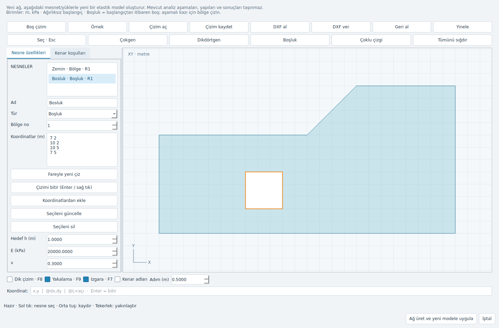
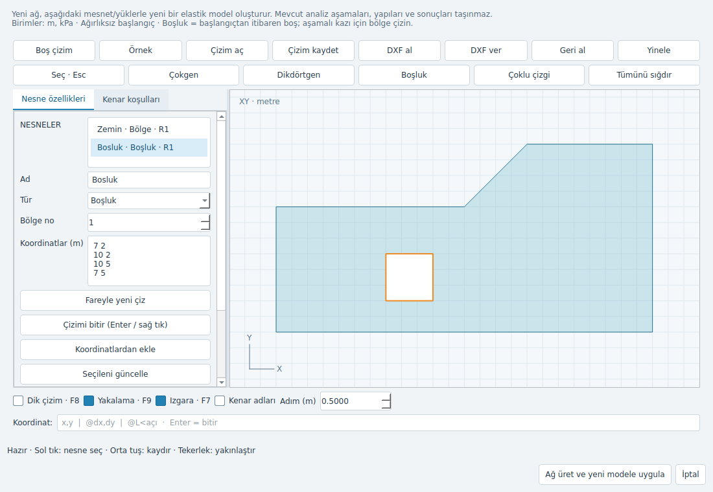
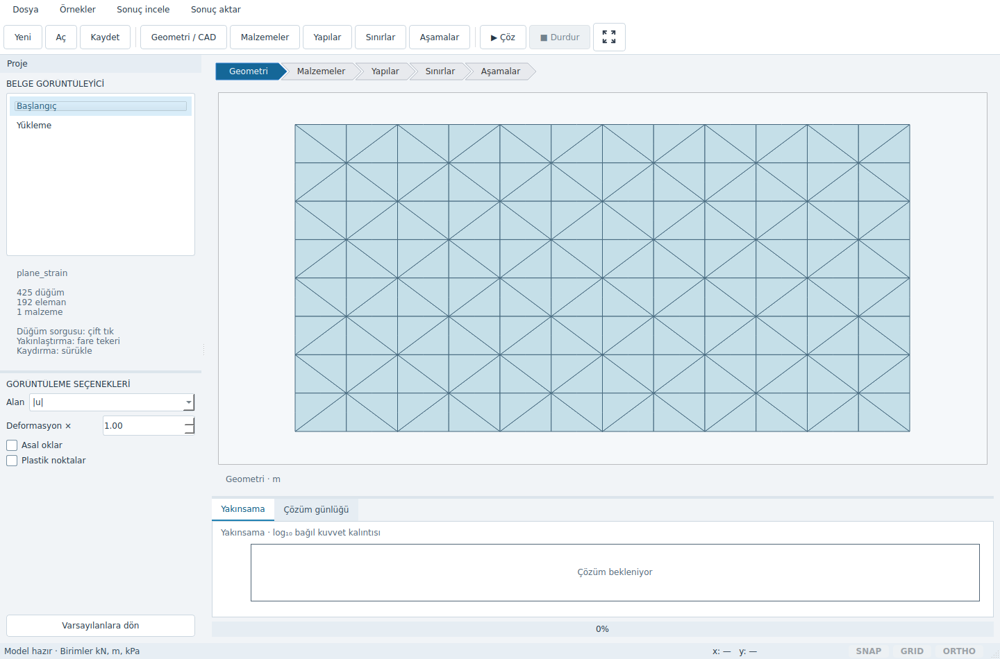

# CAD arayüz düzeltmeleri — 22 Ekim 2026

Release yayını kapalıdır. Bu değişiklikler kullanıcı arayüz kabulünün yerine geçmez.

## Düzeltilen sorunlar

- Açık arka plandaki menü, araç düğmesi ve sekme metinleri sistemin koyu paletinden
  etkilenmiyor. Fusion stili ve açık renklerin tüm ilgili palet rolleri ortak giriş
  noktasından uygulanıyor; CAD penceresi tek başına açıldığında da geçerli.
- Geometri adımı zaten seçiliyken yeniden tıklamak da editörü açıyor.
- Sonuç alanı veya deformasyon değişimi kullanıcının yakınlaştırmasını sıfırlamıyor.
- Model açıldıktan sonra durum çubuğunda “Boş proje” mesajı kalmıyor.
- Izgara görünürlüğü, yakalama ve ızgara aralığı ayrı tutuluyor. Kapat/aç adımı silmiyor.
- Taşan sayısal koordinatlar ve sonsuz kutupsal açılar çizimi bozmadan reddediliyor.

## Çizim çalışma alanı

Nesne özellikleri ve kenar koşulları sol panelde ayrı sekmelerde; dar ekranda
özellikler kaydırılabilir. Çizim alanı genişliğin kalanını kullanır. Sonuç
penceresinin yakınsama/günlük paneli ayırıcıdan küçültülebilir veya kapatılabilir.

| İşlem | Kullanım |
|---|---|
| Nesne seçimi | Çizimde sol tık; iç içe şekillerde en küçük kapsayan alan, kenarda en yakın kenar |
| Çokgen / boşluk / çoklu çizgi | İlgili araç, noktalar, Enter veya sağ tık; Esc iptal |
| Dikdörtgen | Karşılıklı iki köşe; sıfır genişlik/yükseklik reddedilir |
| Kaydırma | Orta tuş basılı sürükle; devam eden çizimde de çalışır |
| Yakınlaştırma | Fare tekerleği; tüm çizim için “Tümünü sığdır” |
| Kesin koordinat | `x,y`, `@dx,dy`, `@uzunluk<açı`; boş Enter bitirir |
| Izgara / dik çizim / yakalama | F7 / F8 / F9 |
| Kenar adları | Gerektiğinde açılabilen etiketler |
| Düzenleme | Seçilen nesnenin koordinatlarını değiştir, “Seçileni güncelle”; geri al/yinele |

İmlece uzanan çizgi veya dikdörtgen önizlemesi ve imleç hedef işareti çizim
sırasında görünür. Yeni araçlar çakışmayan nesne adları üretir. Mevcut yeniden ağ
üretiminin yeni elastik model oluşturma davranışı korunur.

## Doğrulama

`tests/unit/test_cad_usability.py` gerçek Qt fare/klavye olaylarıyla dikdörtgen,
seçim, silme/geri alma, iç içe şekil seçimi, çizim sırasında kaydırma, ızgara,
palet, workflow ve yakınlaştırma regresyonlarını kapsar. Masaüstü CI işine eklendi.

Yerel tam test: **483 geçti, 2 atlandı (PyVista yok), 1 bilinen xfail**;
performans işaretli 2 test kapsam dışı. Son küçük durum mesajı/renk
düzeltmesinden sonra ilgili 17 arayüz testi tekrar geçti. PyVista kurulduktan
sonra görüntüleme, dışa aktarma ve yeni arayüz grubundaki 13 test de geçti;
bağımlılık nedeniyle atlanan kontroller böylece ayrıca tamamlandı. Ruff temiz.

Aşağıdaki görüntüler Linux Qt offscreen ile gerçek widget'lardan alındı;
koyu sistem temasının beyaz yazı paleti simüle edilerek açık tema kontrol edildi. Windows yerel
masaüstü ve yüksek DPI kabulü ayrıca kullanıcı tarafından doğrulanmalıdır.

Bu editör 2B sonlu eleman geometrisi hazırlamak içindir. Tam AutoCAD eşdeğeri,
DWG desteği, yay/spline düzenleme veya sürükleyerek taşıma iddiası yoktur.
