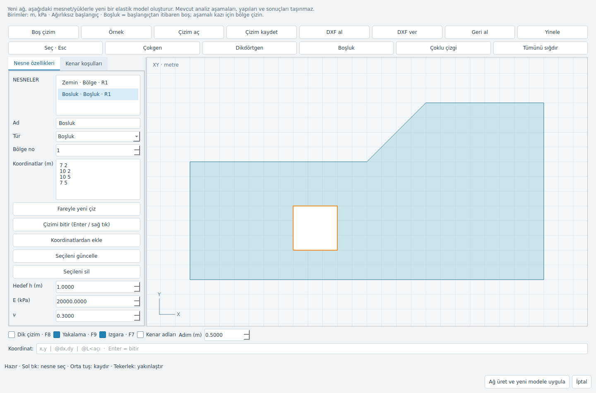
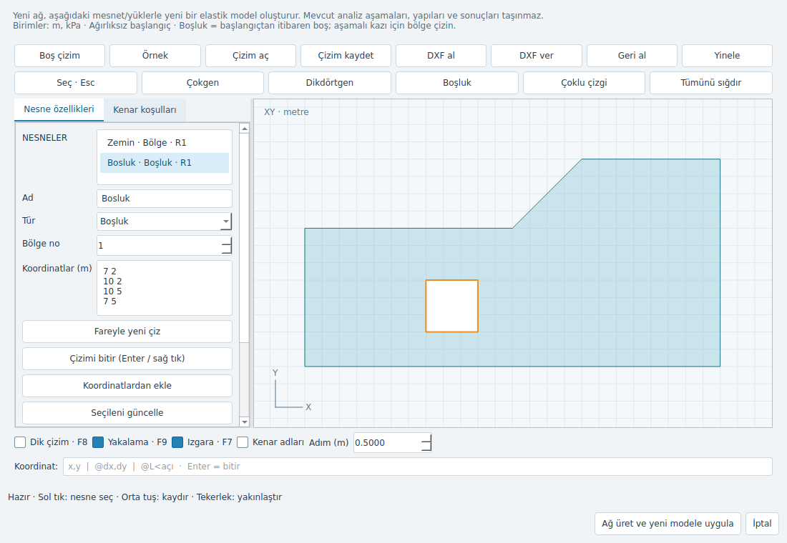
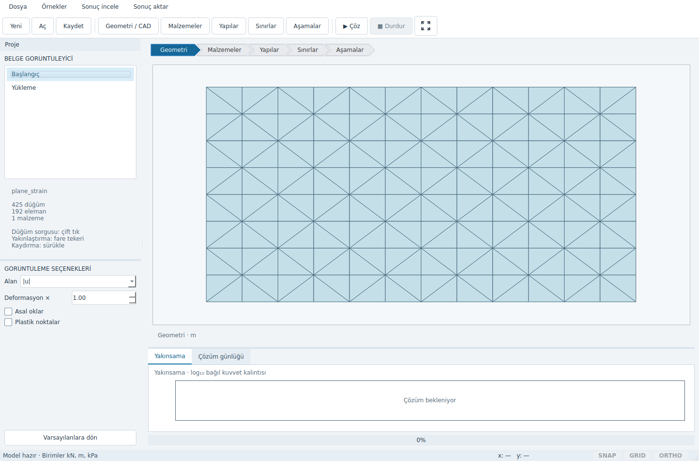

# CAD interface fixes — 22 October 2026

> Current main-window layout: [Integrated modeller](integrated-modeler.md).
> The separate CAD-window images on this page belong to the previous version.

Release publication is closed. These changes do not replace user-interface acceptance.

## Problems that were fixed

- Menu, tool-button, and tab text on a light background is no longer affected by the
  system dark palette. The Fusion style and the light colours are applied to every
  relevant palette role from one shared entry point; they also apply when the CAD
  window is opened on its own.
- Clicking the geometry step again while it is already selected still opens the editor.
- Changing the result field or the deformation does not reset the user’s zoom.
- The status bar no longer keeps the “Empty project” message after a model is opened.
- Grid visibility, snap, and grid spacing are kept separate. Closing and opening does not delete the step.
- Overflowing numeric coordinates and infinite polar angles are rejected without corrupting the drawing.

## Drawing workspace

Object properties and boundary conditions are separate tabs in the left panel; on a
narrow screen the properties scroll. The drawing area uses the remaining width. The
convergence/log panel of the results window can be shrunk from the splitter or closed.

| Action | Use |
|---|---|
| Object selection | Left click on the drawing; the smallest containing area for nested shapes, the nearest edge on an edge |
| Polygon / void / polyline | The matching tool, points, Enter or right click; Esc cancels |
| Rectangle | Two opposite corners; zero width/height is rejected |
| Pan | Drag with the middle button held; also works during an in-progress drawing |
| Zoom | Mouse wheel; “Fit all” for the whole drawing |
| Exact coordinate | `x,y`, `@dx,dy`, `@length<angle`; a blank Enter finishes |
| Grid / ortho / snap | F7 / F8 / F9 |
| Edge names | Labels that can be turned on when needed |
| Editing | Change the coordinates of the selected object, “Update selected”; undo/redo |

A line or rectangle preview that reaches the cursor, and a cursor target mark, are
visible while drawing. New tools produce non-colliding object names. The existing
remesh behaviour of creating a new elastic model is preserved.

## Verification

`tests/unit/test_cad_usability.py` covers rectangle, selection, delete/undo, nested-shape
selection, pan while drawing, grid, palette, workflow, and zoom regressions with real
Qt mouse/keyboard events. It was added to the desktop CI job.

Local full test: **483 passed, 2 skipped (no PyVista), 1 known xfail**;
the 2 tests marked as performance are out of scope. After the last small status-message/colour
fix, the related 17 interface tests passed again. After PyVista was installed, the 13 tests
in viewing, export, and the new interface group also passed; checks that had been skipped
because of the dependency were therefore completed as well. Ruff is clean.

The images below were taken from real widgets with Linux Qt offscreen; the dark system
theme’s white text palette was simulated and the light theme was checked. A local Windows
desktop and high-DPI acceptance still have to be confirmed by the user.

This editor is for preparing 2D finite-element geometry. There is no claim of a full
AutoCAD equivalent, DWG support, arc/spline editing, or drag-to-move.
