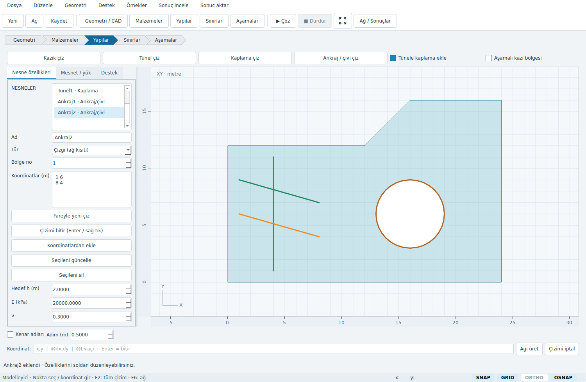
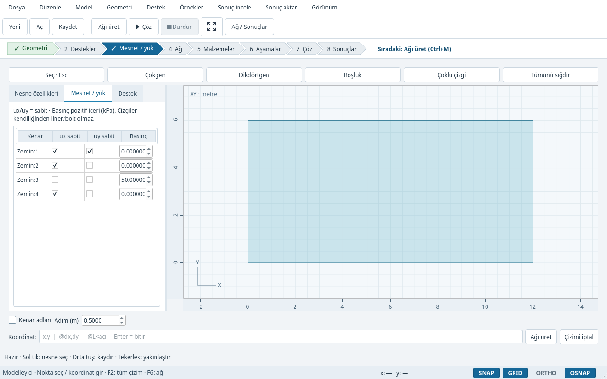
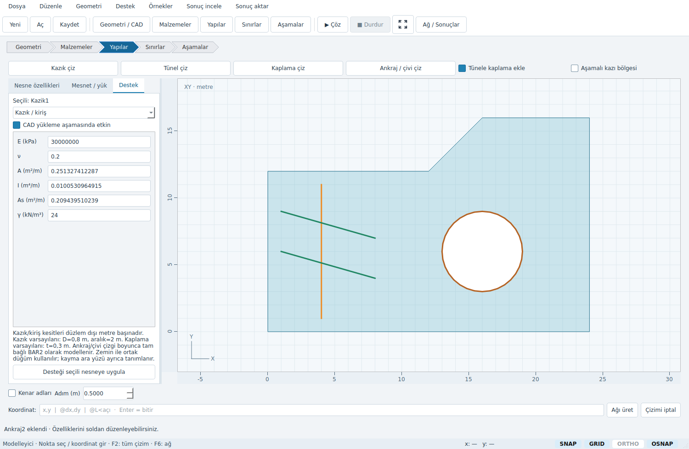
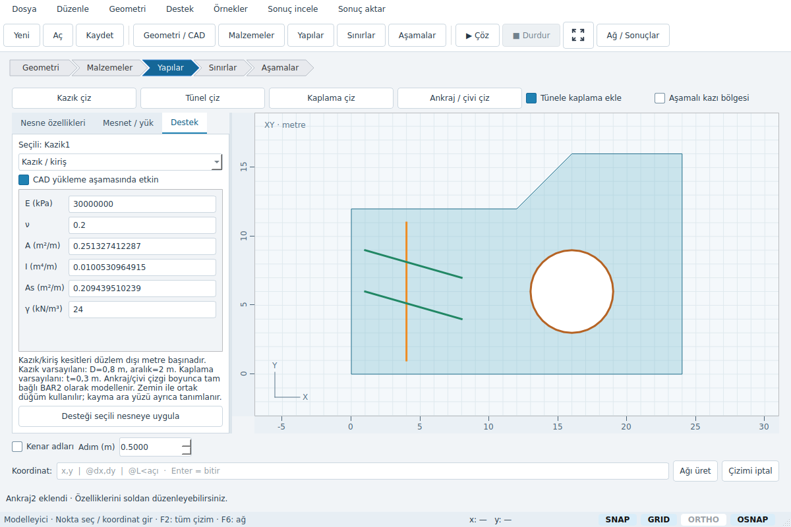

# CAD, piles, tunnels, and supports in the main window

The FEA main window was rearranged after the [Modeler layout](https://github.com/hdaltuntas/SlipSurfaceIQ-LE/blob/main/slipsurface/ui/modeler.py)
and the CAD area of SlipSurfaceIQ-LE were reviewed: menus and the workflow are at the
top, object/fixity/support tabs are on the left, the ruled drawing is in the centre, and
coordinate entry and SNAP / GRID / ORTHO / OSNAP are at the bottom. CAD does not open a
separate window. The modeller and the most recently generated mesh/result view switch
inside the same main window.

## Drawing and calculation flow

1. **New** starts with an empty drawing. Draw a region from the **Geometry** menu; points
   can be entered with the mouse or as `x,y`, `@dx,dy`, `@length<angle`.
2. From the **Structures** step or the **Support** menu, choose a pile, a tunnel, a liner,
   or an anchor/soil nail. A pile and an anchor are completed with two ends. For a liner,
   enter the points and finish with Enter. For a tunnel, pick the centre and a radius point.
3. Select the object from the drawing. On the **Support** tab at the left, change the
   section, stiffness, and activation values and use **Apply support to the selected object**.
4. On the **Fixity / load** tab, define the fixities that prevent rigid-body motion of the
   soil, and the edge pressures. **Generate mesh** turns the drawing into a real FEM mesh.
5. Check the materials and the stages and start the analysis with **Solve**. **F6** shows
   the last generated mesh/results; **Geometry / CAD** shows the current drawing.

| Tool | Geometry | Analysis counterpart |
|---|---|---|
| Pile | Two-point line | BEAM2 sharing nodes with the soil; E, A, I, and As per metre |
| Tunnel | Centre + radius; 32 straight edges | A void, or a separate excavation region |
| Tunnel lining | Around the tunnel | BEAM2 along the perimeter |
| Liner | A polyline, or a selected closed boundary | BEAM2 along the line/boundary |
| Anchor / soil nail | Two-point line | Fully bonded BAR2 along the line; EA and capacity of one nail, made 2D-equivalent by the spacing |

If **staged excavation region** is selected, the tunnel starts full, as a newly numbered
material region. Excavate it by deactivating that region in the stage editor; also select
the liner’s activation in the relevant stage. If it is not selected, the tunnel is a void
from the start.

Individually drawn supports are active by default in **CAD loading**; they can be created
passive from the panel. Designer tunnel supports and manual bolt patterns start inactive
so their installation can be assigned in the stage editor. The pile default section is
D = 0.8 m and the out-of-plane spacing
is 2 m; the liner thickness is t = 0.3 m. Edit these starting values for your own project.

Drawn supports are fully bonded to the soil. Slip/separation interfaces and end-anchored
bolts are defined from the advanced structure editor on the existing mesh. The tunnel tool
approximates a circular section with a polygon; other sections are made with the
polygon/coordinate editor.

## Stage tabs and project properties

Placing a tunnel from the designer now adds its regions and inactive supports without
creating excavation/support stages. Your existing stage count and names stay unchanged.
Use project properties and the stage editor to define excavation, relaxation and support
installation. The designer's **Disturbance** tab defines the halo geometry; choose its
disturbed material in the required stage yourself. Existing saved schedules are retained.

The model/CAD canvas and the mesh/results canvas both have bottom stage tabs. Selecting
a tab also selects the same stage in the document viewer. CAD region labels and fills
show the selected stage's material or excavation state; selecting a stage does not edit it.

Use **Model > Project properties…** to set construction-stage count and names. The fixed
**0. Initial** state is additional to that count. Renaming keeps loads, water, support
activation, material overrides and relaxation factors. Increasing the count copies the
last stage, with full load release and displacement reset off. Decreasing the count
removes stages from the end. The existing **Model > Stages…** editor still controls the
complete stage definitions. Project properties also works on an unmeshed drawing;
draft names are stored in `.sscad.json` and used during mesh generation.

After generating the mesh, define intact and softened/disturbed materials in
**Model > Materials…**. Select a bottom stage tab, right-click the region on either
canvas, and choose **Assign materials…**. It is the only region context-menu command. Pick a material or
**Excavated (void)**. Only the selected stage changes unless **Apply to this and all
following stages** is checked. This assigns an existing material definition; it does
not introduce a new strain-softening constitutive law. Changing Initial alone preserves
later stages' material definitions with explicit overrides.

For excavation, choose **Excavated (void)** in that same material list. The optional
following-stages checkbox controls its scope. Geometry and material definitions are
retained; choosing a material reactivates the region. The dialog shows the selected
stage and region. Before meshing, or after geometry changes, the assignment command is
disabled with a tooltip explaining that mesh generation is required.

## Selected-element results and manual bolt patterns

Under **Display options > Model element**, select a soil region, lining/pile, bolt or
interface. The list covers all model regions and structural objects, including inactive
ones. **Field** then offers results supported by that object: beams have N/V/M; bolts
have axial N; interfaces have nodal displacement. Soil regions have the continuum fields.
**Whole model** returns to the overall contour view.

N/V/M displays one selected member at a time against a subdued model background. Its
diagram is scaled to that member's dimensions, with **Diagram ×** for adjustment. At
curved joints the drawing normals are shared; actual end-force jumps are preserved.
Disconnected chains, branches and inactive gaps are never bridged. Extremes appear in
the legend and values in tooltips. **Open element charts…** opens the selected member's
force/displacement charts, including the along-length view, in the selected stage.
An inactive member stays in that stage and reports no active result.

Tunnel designer placement adds no automatic bolts, including when loading older
saved designs that contain bolt definitions. Existing bolts already in a project are
preserved. Define bolts explicitly in the model workspace:

1. Choose **Support > Bolt pattern (drag along boundary)…** or the matching toolbar icon.
2. Press on a lining or boundary and hold the left mouse button while following the
   desired interval. The blue line and dashed bolts preview the selection. Release
   on the boundary to finish; a click alone inserts nothing. A coincident lining is
   preferred to a region boundary, avoiding internal excavation divider edges.
3. Set spacing, length, angle/side, end margin and properties in the dialog. Changes
   update the canvas preview. **OK** inserts the previewed bolts; Cancel or Esc leaves
   the drawing unchanged. Reversing the drag does not reverse the bolt directions.

Only the selected interval receives bolts, including selections across a closed
boundary's first vertex. Spacing between adjacent heads is exact; leftover length is
shared at the interval ends. Out-of-plane spacing is separate. Bolts start inactive
unless **Activate immediately in all stages** is checked; assign their installation
using **Model > Stages**. One undo removes the entire pattern. Splitting host edges
retains their fixities and pressures. Other geometry tools remain on the toolbar;
double-click still opens object properties.

A corner drag that would self-intersect/collapse a polygon or produce invalid topology
is rejected with an inline message. Geometry, selection and undo/redo history remain
unchanged; a valid subsequent move can still be undone normally.

Applying project or material changes clears old results and keeps the selected stage
and workspace. Save the meshed model as `.ssproj` to retain all material assignments.
Remeshing preserves those assignments and does not restore deleted/renamed stages.
If the drawing has changed since meshing, regenerate it before editing model stage
definitions or assigning materials; this prevents editing against stale region IDs.

## Save, undo, and remeshing

- `.sscad.json` stores the drawing, the fixities/loads, and the support definitions. The
  new format is v2; old v1 drawings are also read. **Save** opens the drawing record when
  there is a draft that still needs a mesh; it saves a completed model as `.ssproj`.
- The `geometry` entry inside `.ssproj` carries the drawing together with its supports.
  On reopen, the CAD and the real FEM support properties are kept. Changing or deleting
  the property of a CAD-linked support in the advanced editor is reflected in the drawing
  definition as well.
- Geometry/support edits can be undone. Mesh generation does not clear the drawing undo
  history. Unsaved drawings are protected when the window closes.
- Once the drawing changes, solving against the old mesh and saving `.ssproj` are blocked.
  The mesh must be generated again first, or the draft must be saved separately.
- Remeshing transfers the current model’s definitions onto the new mesh (`cad/transfer.py`).
  The drawing is authoritative for what it defines itself: regions, CAD supports, edge
  fixities, and CAD pressures. Everything else is matched by name: the material library
  and region assignments, the initial stress, the solver settings, the stages (load, water,
  region/structure activity, material change), extra fixities, and interfaces/liners/bolts
  added by the advanced editor. Interfaces and structures are rebuilt on the named edge
  they were attached to. Point loads and bolt ends tied to a node move to the nearest new
  node. Newly drawn regions and supports start active in every stage. Definitions that no
  longer have a target are removed and listed one by one in the **Solution log**. Results
  are deleted because they are invalid on the new mesh. Old projects that have no CAD input
  open, but geometry is not extracted automatically from the existing mesh.

## Workflow bar and layout

The full-width row under the menus shows eight numbered steps: Geometry › Supports ›
Fixity / load › Mesh › Materials › Stages › Solve › Results. Completed steps are green
with a ✓; the active step is dark blue; the text on the right states the next step.
Clicking a step opens the related drawing tab or editor. **Mesh** generates the mesh;
**Solve** starts the solution. Editors at the mesh-set level are in the **Model** menu.

The project panel and the convergence/log panel are opened and closed from the **View**
menu. **Reset layout** returns to the default arrangement. Window size, panel choices,
and splitter positions are saved to the user settings (INI) on close. The theme stays
light regardless of Windows dark mode: the Qt ≥ 6.8 colour scheme is pinned to light,
and `QT_QPA_PLATFORM=windows:darkmode=0` is used on Windows. Palette and style pairs
pass the WCAG AA (≥ 4.5:1) contrast test.

## Controls

| Action | Shortcut |
|---|---|
| Last generated mesh/result | F6 |
| Fit the drawing or the mesh | F2 |
| Snap to grid | F9 / SNAP |
| Grid visibility | F7 / GRID |
| Horizontal/vertical drawing | F8 / ORTHO |
| End/midpoint snap | F3 / OSNAP |
| Pan / zoom | Middle button / wheel |
| Undo / redo | Ctrl+Z / Ctrl+Y |

## Verification

Full repository run: **493 passed, 1 known xfail** (2 performance tests out of scope).
Ruff and diff whitespace checks are clean. The last keyboard/default-button fix was tested separately.

`test_integrated_modeler.py`: embedding in the main window and a visible mesh button,
support drawing with real mouse events, mesh connectivity and an elastic solve, staged
excavation with a liner, support properties/rename/delete/undo, the drawing and project
save round trip, the block on solving/saving against an old mesh, protection of an unsaved
drawing, v1 compatibility, independence of SNAP/OSNAP, and consistency of the support
definition with the advanced editor.

The images were taken from real Qt widgets in a Linux offscreen environment.
Windows high-DPI visual acceptance and the user review are not finished yet.
Release publication is closed.
