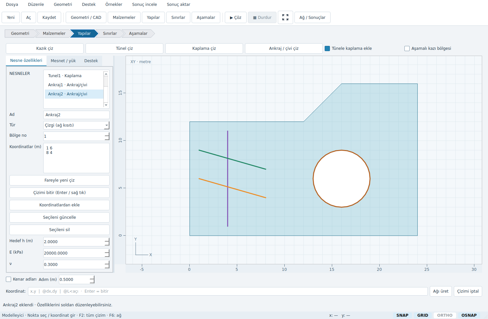
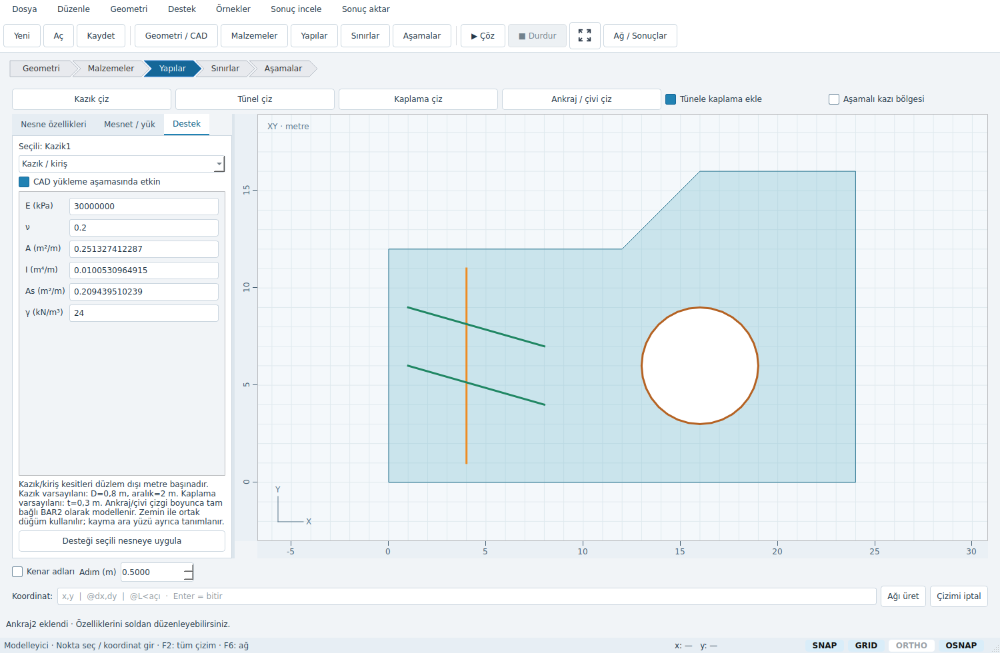
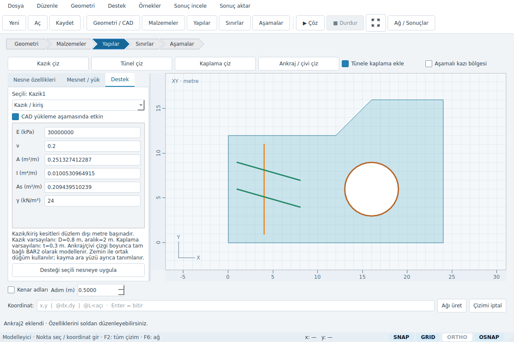

# Ana pencerede CAD, kazık, tünel ve destekler

SlipSurfaceIQ-LE'nin [Modeler düzeni](https://github.com/hdaltuntas/SlipSurfaceIQ-LE/blob/main/slipsurface/ui/modeler.py)
ve CAD alanı incelenerek FEA ana penceresi yeniden düzenlendi: menüler ve iş akışı
üstte, nesne/mesnet/destek sekmeleri solda, cetvelli çizim ortada, koordinat girişi
ve SNAP / GRID / ORTHO / OSNAP altta. CAD ayrı bir pencere açmaz. Modelleyici ile
son üretilmiş ağ/sonuç görünümü aynı ana pencerede değişir.

## Çizim ve hesap akışı

1. **Yeni**, boş çizimle başlar. **Geometri** menüsünden bölge çizin; noktalar
   fareyle veya `x,y`, `@dx,dy`, `@uzunluk<açı` ile girilebilir.
2. **Yapılar** adımı veya **Destek** menüsünden kazık, tünel, kaplama veya
   ankraj/zemin çivisi seçin. Kazık ve ankraj iki uçla tamamlanır. Kaplamada
   noktaları girip Enter ile bitirin. Tünelde merkez ve yarıçap noktasını seçin.
3. Nesneyi çizimden seçin. Soldaki **Destek** sekmesinde kesit, rijitlik ve
   etkinlik değerlerini değiştirip **Desteği seçili nesneye uygula** düğmesini kullanın.
4. **Mesnet / yük** sekmesinde zeminin rijit hareketini önleyecek mesnetleri ve
   kenar basınçlarını tanımlayın. **Ağı üret** çizimi gerçek FEM ağına dönüştürür.
5. Malzemeleri ve aşamaları kontrol edip **Çöz** ile analizi başlatın. **F6** son
   üretilen ağı/sonuçları, **Geometri / CAD** mevcut çizimi gösterir.

| Araç | Geometri | Hesap karşılığı |
|---|---|---|
| Kazık | İki noktalı çizgi | Zeminle ortak düğümlü BEAM2; E, A, I ve As metre başına |
| Tünel | Merkez + yarıçap; 32 doğrusal kenar | Boşluk veya ayrı kazı bölgesi |
| Tünel kaplaması | Tünel çevresi | Çevre boyunca BEAM2 |
| Kaplama | Çoklu çizgi veya seçili kapalı sınır | Çizgi/sınır boyunca BEAM2 |
| Ankraj / zemin çivisi | İki noktalı çizgi | Çizgi boyunca tam bağlı BAR2; EA ve kapasite tek çivi, aralıkla 2B eşdeğer |

**Aşamalı kazı bölgesi** seçilirse tünel başlangıçta dolu, yeni numaralı bir
malzeme bölgesidir. Aşamalar editöründe bu bölgeyi pasifleştirerek kazın; kaplamanın
etkinliğini de ilgili aşamada seçin. Seçilmezse tünel başlangıçtan itibaren boşluktur.

Yeni destekler varsayılan olarak **CAD yükleme** aşamasında etkindir; panelden
pasif oluşturulabilir. Kazık varsayılan kesiti D=0,8 m ve düzlem dışı aralık=2 m;
kaplama t=0,3 m. Bu başlangıç değerlerini kendi projenize göre düzenleyin.

Çizilen destekler zemine tam bağlıdır. Kayma/ayrılma ara yüzleri ve uçtan ankrajlı
boltlar mevcut ağdaki gelişmiş yapı editöründen tanımlanır. Tünel aracı dairesel
kesiti çokgenle yaklaştırır; farklı kesitler çokgen/koordinat düzenleyicisiyle yapılır.

## Kayıt, geri alma ve yeniden ağ

- `.sscad.json` çizim, mesnet/yük ve destek tanımlarını saklar. Yeni biçim v2,
  eski v1 çizimleri de okunur. **Kaydet**, ağ gerektiren bir taslak varsa çizim
  kaydını açar; tamamlanmış modeli `.ssproj` olarak kaydeder.
- `.ssproj` içindeki `geometry` girdisi desteğiyle birlikte çizimi taşır. Yeniden
  açıldığında CAD ve gerçek FEM destek özellikleri korunur. Gelişmiş editörde
  CAD bağlantılı desteğin özelliğini değiştirmek/silmek çizim tanımına da yansır.
- Geometri/destek düzenlemeleri geri alınabilir. Ağ üretimi çizim geri alma
  geçmişini temizlemez. Pencere kapanırken kaydedilmemiş çizimler korunur.
- Çizim değişince eski ağla çözüm ve `.ssproj` kaydı engellenir. Önce yeniden ağ
  üretilmeli veya taslak ayrı kaydedilmelidir.
- Yeniden ağ, CAD mesnetleri ve destekleriyle yeni ağırlıksız elastik model kurar.
  Önceki özel malzemeler, analiz aşamaları, ara yüzler ve sonuçlar aktarılmaz;
  mevcut modele dönülünce bu bilgi çizim ekranında görünür. CAD girdisi olmayan
  eski projeler açılır, fakat mevcut ağdan otomatik geometri çıkarılmaz.

## Kontroller

| İşlem | Kısayol |
|---|---|
| Son üretilen ağ/sonuç | F6 |
| Çizimi veya ağı sığdır | F2 |
| Izgaraya yakalama | F9 / SNAP |
| Izgara görünürlüğü | F7 / GRID |
| Yatay/düşey çizim | F8 / ORTHO |
| Uç/orta nokta yakalama | F3 / OSNAP |
| Kaydır / yakınlaştır | Orta tuş / tekerlek |
| Geri al / yinele | Ctrl+Z / Ctrl+Y |

## Doğrulama

Tam depo koşusu: **493 geçti, 1 bilinen xfail** (2 performans testi kapsam dışı).
Ruff ve diff boşluk kontrolleri temiz. Son klavye/varsayılan düğme düzeltmesi ayrıca test edildi.

`test_integrated_modeler.py`: ana pencereye gömülme ve görünür ağ düğmesi, gerçek
fare olaylarıyla destek çizimi, ağ bağlantısı ve elastik çözüm, kaplamalı aşamalı
kazı, destek özellikleri/yeniden adlandırma/silme/geri alma, çizim ve proje kayıt
çevrimi, eski ağla çözüm/kayıt engeli, kaydedilmemiş çizimi koruma, v1 uyumluluğu,
SNAP/OSNAP bağımsızlığı ve gelişmiş editörle destek tanımı tutarlılığı.

Görüntüler gerçek Qt widget'larından Linux offscreen ortamında alınmıştır.
Windows yüksek DPI görsel kabulü ve kullanıcı değerlendirmesi henüz tamamlanmadı.
Release yayını kapalıdır.
