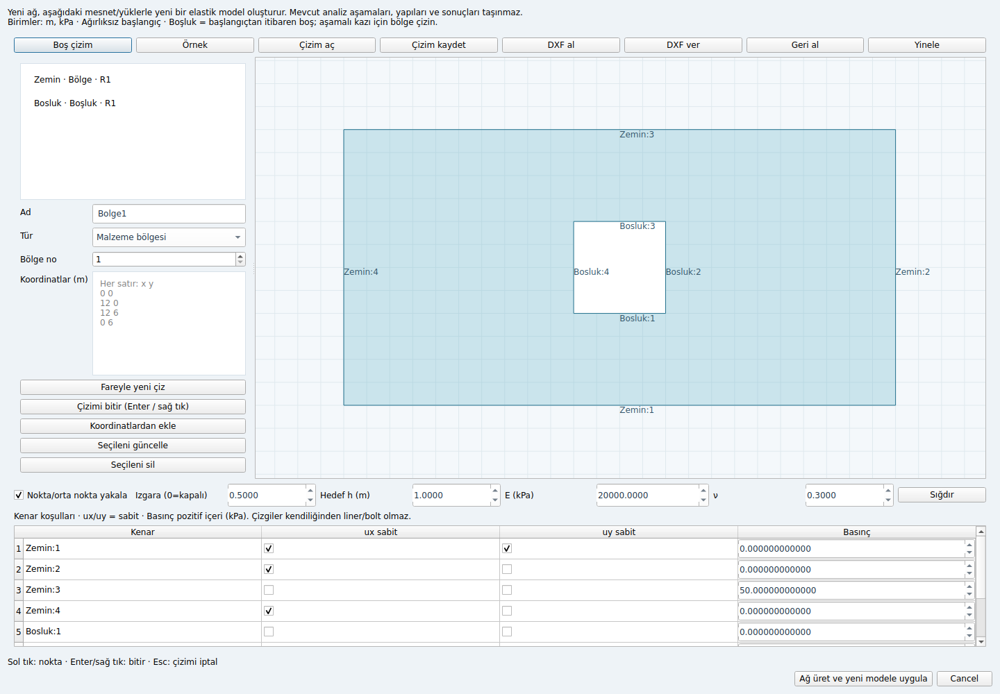

# Phase 5.2 — native CAD and mesh-from-drawing

> Current main-window layout: [Integrated modeller](integrated-modeler.md).
> The separate CAD-window images on this page belong to the previous version.

PR #3 was merged to `main` as `de1f12a`. This delivery is built on top of that.
**Gate 5/v1.0 is not complete.**



## Use

```bash
python -m pip install -e ".[dev,gui]"
python -m slipsurface.fe2d.gui
```

1. Open **Geometry / CAD**. Load the rectangle that already has fixities and a load with
   **Example**, or choose `examples/cad/rectangle-with-void.sscad.json` with **Open drawing**.
2. Give the new item a unique name, a type, and a region number. After **Draw new with the mouse**,
   enter points with the left button; Enter/right click finishes, Esc cancels a half-drawn item.
   You can also add coordinates as `x y` per line, or edit the selected item.
3. Point/edge-midpoint snap is within 10 screen pixels. A positive grid spacing snaps to
   the metric grid; `0` leaves point snap only. The wheel zooms; dragging outside the
   drawing pans. **Fit** shows the whole geometry.
4. Assign ux/uy fixities and the pressure in the edge table. Names have the form `Item:1`,
   `Item:2`, …; the coordinate list sets the order. Pressure is positive inward, in kPa.
5. Choose the target h, E, and ν and use **Generate mesh and apply to a new model**.
   In the main window, **Solve** starts the analysis; the existing result exports can be used.

Adding/updating/deleting geometry and changing the drawing can be undone/redone.
When an item’s coordinates or name change, **that item’s boundary conditions are cleared**;
assign them again. Undo restores the old geometry and its conditions together. Individual
cell edits in the fixity/load table are not independent undo commands.

## Model and record contract

- Mesh generation from a drawing creates a **new** plane-strain elastic model that is
  weightless and has no initial stress. Every region is first assigned the same E/ν.
  Materials, stages, structures, and results of the previous model are not transferred
  automatically; this behaviour is stated explicitly in the window. Transfer of FE
  assignments after remeshing is not in the scope of this delivery.
- Regions are preserved in the mesh under separate numbers. In nested regions the innermost
  region wins; neighbouring regions that share an edge are allowed. Partial area overlaps
  are rejected.
- A **void** is a region with no elements from the start. For staged excavation, use a
  material region instead of a void; deactivate it in the existing stage editor.
- A line is a named edge chain that the mesh will follow; it is not an automatic liner/bolt.
- `.sscad.json` stores the drawing that has not been meshed yet, and its boundary conditions.
  The optional `geometry` field inside `.ssproj` and the model JSON carries the CAD input
  that produced the last mesh. The solver does not use this field; the calculation always
  runs on the saved FE mesh. Older projects that have no CAD field open; CAD is not
  reconstructed from the mesh.
- Shapely and ezdxf are only extra dependencies of `gui`; the core solver does not need them.

## DXF scope

On DXF import, **metres / DXF unit** is chosen explicitly (m=1, cm=0.01, mm=0.001).
This factor is applied independently of the `$INSUNITS` tag. The output unit is metres.

Supported model-space entities: straight `LINE`, straight open/closed `LWPOLYLINE`, and 2D
`POLYLINE`. Closed polylines are regions; closed polylines on a `HOLE*` layer are voids.
Native DXF output preserves name/type/region in XDATA. For an external DXF, check these
assignments in the window. Fixities/loads and material properties are not carried by DXF.

Bulge/arc, ARC/CIRCLE, SPLINE, INSERT/block, TEXT, and coordinates outside the XY plane
cause **the whole file to be rejected**. A partial drawing is not imported silently; first
convert these entities to supported flat 2D pieces, or prepare a separate DXF.
DWG, block explosion, and curve approximation are later work.

## Guards and verification

- Self-intersecting/repeated/zero-area polygons, invalid numbers, lines outside the ground,
  voids that touch the outer boundary, and overlapping voids are rejected. A void cannot
  cut a region boundary; a void drawing that cuts through layers is not supported yet.
- Fixities must restrain both translations and the rotation of every connected mesh part.
  This check is not a guarantee of every mechanism or of nonlinear convergence.
- Pressure is applied only to a real outer/void boundary; pressure on an internal region
  boundary, and a repeated pressure assignment on the same mesh edge, are rejected.
- The mesh is generated on a separate Qt worker. Cancel is checked between refinement
  rounds; it does not forcibly cut a single in-progress Qhull/PSLG operation. An error or
  a cancel does not change the main model. This CAD builder has an upper limit of 100,000
  points; above that it raises an explicit error.
- At large map coordinates, `Domain.add_polygon` could drop the last vertex by mistake
  because of a relative `allclose`. Closure is now recognised by exact equality; the area
  is computed after a shift into local coordinates. The four corners and the 72 m² area of
  a 12 × 6 m polygon at coordinates 1,000,000/2,000,000 m were tested.

Local Linux/Python 3.12 full regression: **423 passed, 1 strict xfail, 2 benchmarks excluded;
95.18 s**. After the last interface/input changes, the CAD/desktop/record subset:
**50 passed**. Ruff and `git diff --check` succeeded. Real Qt mouse/keyboard events,
undo/redo, cancel/error, both project formats, DXF scale, and rejection of a lossy
transfer were tested. A uniform-pressure model taken from the CAD builder satisfies the
analytical plane-strain solution; the Qt worker result is bit-identical to the direct API.

The Linux/Windows GUI CI job also runs the new CAD tests.

On the first CI attempt, 35 GUI tests passed but a Qt error occurred as the process closed.
The same sequence was reproduced locally with `exit 139`. Instead of a separate QApplication
lifetime per test module, a single application object for the session and widget/deferred-delete
cleanup after every test are used. The same 35 tests finished with `exit 0`; no test skipping
or ignoring of the exit code was added. The wheel package also built successfully.

## Next delivery

New material/region assignment, liner/bolt, and load/water builders; stage add/delete/reorder
and a timeline. Then building the original four-stage tunnel without code and comparing it
with the API; finishing the result plots and the Windows portable package.
The deferred status of the S4 external comparison and the legacy P4 strict-xfail limit do not change.

Follow-on delivery: with [Phase 5.3](phase5-model-editors.md), new materials, region
assignments, liners/bolts, loads/water, and stages can be built after the mesh. Automatic
transfer of these FE definitions during remeshing is not in this scope.
