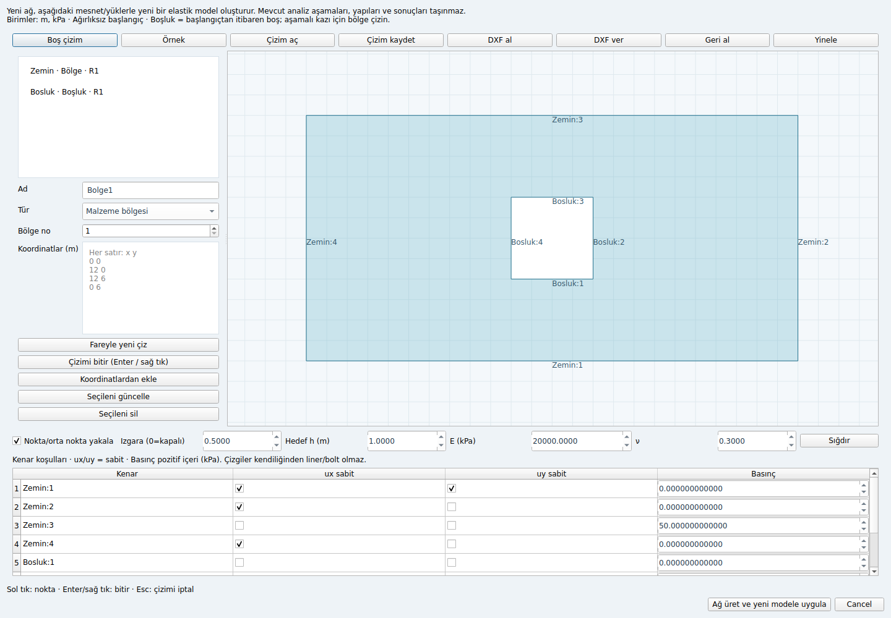

# Faz 5.2 — native CAD ve çizimden ağ

PR #3, `de1f12a` ile `main` dalına birleştirildi. Bu teslim onun üzerine kuruludur.
**Kapı 5/v1.0 tamamlanmış değildir.**



## Kullanım

```bash
python -m pip install -e ".[dev,gui]"
python -m slipsurface.fe2d.gui
```

1. **Geometri / CAD** düğmesini açın. **Örnek** ile mesnetleri ve yükü atanmış
   dikdörtgeni yükleyin veya **Çizim aç** ile
   `examples/cad/rectangle-with-void.sscad.json` dosyasını seçin.
2. Yeni öğeye benzersiz ad, tür ve bölge numarası verin. **Fareyle yeni çiz** ardından
   sol tıkla noktaları girin; Enter/sağ tık bitirir, Esc yarım çizimi iptal eder.
   Koordinatları satır başına `x y` girerek de ekleyebilir veya seçili öğeyi değiştirebilirsiniz.
3. Nokta/kenar ortası yakalama 10 ekran pikseli içindedir. Pozitif ızgara aralığı
   metrik ızgaraya yakalar; `0` yalnız nokta yakalamayı bırakır. Tekerlek yakınlaştırır;
   çizim dışında sürükleme kaydırır. **Sığdır** tüm geometriyi gösterir.
4. Kenar tablosunda ux/uy mesnetlerini ve basıncı atayın. Adlar `Öğe:1`, `Öğe:2`, …
   biçimindedir; sırayı koordinat listesi belirler. Basınç pozitif içeri, birimi kPa.
5. Hedef h, E ve ν seçip **Ağ üret ve yeni modele uygula** düğmesini kullanın.
   Ana pencerede **Çöz** ile analiz başlatılır; mevcut sonuç dışa aktarımları kullanılabilir.

Geometri ekleme/güncelleme/silme ve çizim değiştirme işlemleri geri alınabilir/yinelenebilir.
Bir öğenin koordinatları veya adı değiştirildiğinde **o öğenin kenar koşulları temizlenir**;
yeniden atayın. Geri al eski geometri ve koşullarını birlikte getirir. Mesnet/yük tablosundaki
tek tek hücre düzenlemeleri bağımsız undo komutları değildir.

## Model ve kayıt sözleşmesi

- Çizimden ağ üretimi **yeni**, düzlem şekil değiştirme, ağırlıksız ve başlangıç
  gerilmesiz elastik model oluşturur. Tüm bölgelere başlangıçta aynı E/ν atanır.
  Önceki modelin malzemeleri, aşamaları, yapıları ve sonuçları otomatik taşınmaz;
  bu davranış pencerede açıkça yazılıdır. Yeniden ağlama sonrası FE atama aktarımı
  bu teslimin kapsamında değildir.
- Bölgeler ayrı numaralarla ağda korunur. İç içe bölgelerde en içteki bölge geçerlidir;
  ortak kenarlı komşu bölgeler mümkündür. Kısmi alan çakışmaları reddedilir.
- **Boşluk**, başlangıçtan itibaren eleman bulunmayan alandır. Aşamalı kazı için
  boşluk yerine malzeme bölgesi kullanılır; mevcut aşama düzenleyicisinde pasifleştirilir.
- Çizgi, ağın izleyeceği adlandırılmış kenar zinciridir; otomatik liner/bolt değildir.
- `.sscad.json`, henüz ağlanmamış çizimi ve kenar koşullarını saklar. `.ssproj` ve
  model JSON içindeki isteğe bağlı `geometry` alanı, son ağı üreten CAD girdisini taşır.
  Çözücü bu alanı kullanmaz; hesap daima kaydedilmiş FE ağı üzerinden yapılır.
  Eski, CAD alanı olmayan projeler açılır; ağdan CAD geri çıkarımı yapılmaz.
- Shapely ve ezdxf yalnız `gui` ek bağımlılıklarıdır; çekirdek çözücü bunları gerektirmez.

## DXF kapsamı

DXF alırken **metre / DXF birimi** açıkça seçilir (m=1, cm=0.01, mm=0.001).
Bu katsayı `$INSUNITS` etiketinden bağımsız uygulanır. Çıktı birimi metredir.

Desteklenen modelspace öğeleri: düz `LINE`, düz açık/kapalı `LWPOLYLINE` ve 2D
`POLYLINE`. Kapalı çizgiler bölgedir; `HOLE*` katmanındaki kapalı çizgiler boşluktur.
Native DXF çıktıları ad/tür/bölgeyi XDATA ile korur. Harici DXF için bu atamaları
pencerede kontrol edin. Mesnet/yük ve malzeme özellikleri DXF ile taşınmaz.

Yay/bulge, ARC/CIRCLE, SPLINE, INSERT/blok, TEXT ve XY düzlemi dışındaki koordinatlar
**dosyanın tamamının reddedilmesine** yol açar. Kısmi çizim sessizce alınmaz; önce bu
öğeleri desteklenen düz 2D parçalara dönüştürün veya ayrı bir DXF hazırlayın.
DWG, blok çözme ve eğri yaklaşımı sonraki işlerdir.

## Koruma ve doğrulama

- Kendini kesen/tekrarlı/sıfır alanlı poligonlar, geçersiz sayılar, zemin dışı çizgiler,
  dış sınıra değen boşluklar ve çakışan boşluklar reddedilir. Boşluk bir bölge sınırını
  kesemez; katmanları kesen boşluk çizimi henüz desteklenmez.
- Mesnetlerin her bağlantılı ağ parçasındaki iki öteleme ve dönmeyi engellemesi gerekir.
  Bu kontrol her türlü mekanizmanın veya nonlinear yakınsamanın garantisi değildir.
- Basınç yalnız gerçek dış/boşluk sınırına uygulanır; iç bölge sınırına basınç ve aynı
  ağ kenarına yinelenen basınç ataması reddedilir.
- Ağ ayrı Qt işçisinde üretilir. İptal refinman turları arasında kontrol edilir;
  devam eden tek Qhull/PSLG işlemini zorla kesmez. Hata/iptal ana modeli değiştirmez.
  Bu CAD kurucusunda üst sınır 100.000 nokta; aşılırsa açık hata.
- Büyük harita koordinatlarında `Domain.add_polygon` göreli `allclose` nedeniyle
  son köşeyi yanlışlıkla kaldırabiliyordu. Kapanış artık tam eşitlikle tanınır;
  alan hesabı yerel koordinatlara ötelenerek yapılır. 1.000.000/2.000.000 m
  koordinatlarında 12 × 6 m poligonun dört köşesi ve 72 m² alanı test edildi.

Yerel Linux/Python 3.12 tam regresyon: **423 geçti, 1 strict xfail, 2 benchmark hariç;
95.18 s**. Son arayüz/girdi değişikliklerinden sonra CAD/masaüstü/kayıt alt kümesi:
**50 geçti**. Ruff ve `git diff --check` başarılı. Gerçek Qt fare/klavye olayları,
undo/redo, iptal/hata, iki proje biçimi, DXF ölçeği ve kayıplı aktarım reddi test edildi.
CAD kurucusundan alınan uniform basınçlı model analitik düzlem şekil değiştirme
çözümünü sağlar; Qt işçi sonucu doğrudan API ile bit düzeyinde aynıdır.
Linux/Windows GUI CI işi yeni CAD testlerini de çalıştırır.

İlk CI denemesinde 35 GUI testi geçmesine rağmen süreç kapanışında Qt hatası oluştu.
Aynı sıra yerelde de `exit 139` ile yeniden üretildi. Test modüllerinin ayrı QApplication
ömürleri yerine oturum boyunca tek uygulama nesnesi ve her testten sonra widget/deferred
delete temizliği kullanıldı. Aynı 35 test `exit 0` ile bitti; test atlama veya çıkış kodunu
yok sayma eklenmedi. Wheel paketi de başarıyla derlendi.

## Sıradaki teslim

Yeni malzeme/bölge atama, liner/bolt ve yük/su kurucuları; aşama ekle/sil/sırala
ve zaman çizelgesi. Ardından özgün dört aşamalı tüneli kodsuz kurma ve API
karşılaştırması; sonuç grafiklerinin tamamlanması ve Windows portable paketi.
S4 dış karşılaştırmasının ertelenmiş durumu ve eski P4 strict xfail sınırı değişmez.
