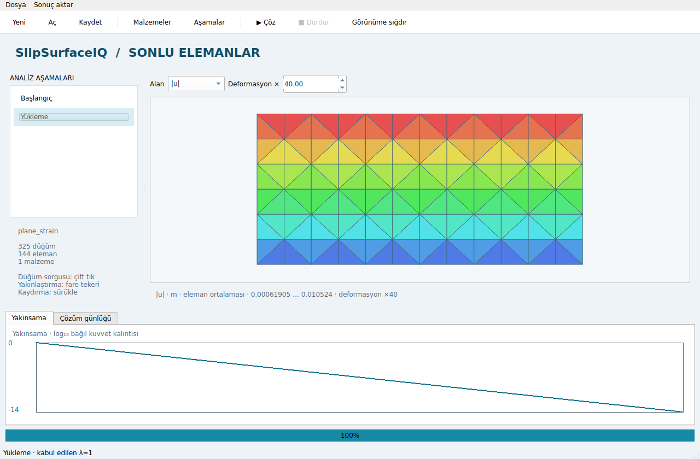

# Faz 5.1 — çalışan masaüstü başlangıcı

Faz 4 sonrasındaki ilk Faz 5 teslimidir. Native **PySide6 / Qt Widgets** uygulamasıdır;
web sunucusu veya tarayıcı arayüzü kullanmaz. **Kapı 5 ve v1.0 tamamlanmış değildir.**

## Kurulum ve çalıştırma

```bash
python -m pip install -e ".[dev,gui]"
python -m slipsurface.fe2d.gui
# veya
slipsurface-fe2d model.ssproj
```



## Bu teslimde çalışanlar

- Native pencere, proje açma/kaydetme, `.ssproj` ve model JSON okuma.
- Kodsuz dikdörtgen T6 zemin modeli: boyutlar, ağ bölümleri, E/ν ve üst basınç.
  Bu kurucu ağırlıksız, başlangıç gerilmesiz, düzlem şekil değiştirme modelidir.
- Yüklü modelin mevcut malzemelerindeki sayısal bünye parametreleri, birim ağırlıklar
  ve drenaj tipi; değişiklikler doğrulandıktan sonra uygulanır.
- Mevcut aşamaların adı, yük serbest bırakma oranı, drenaj seçimi, aktif bölgeleri ve
  yapıları. Yükler, su sınırları ve zorlanmış yer değiştirmeler korunur.
- Ayrı Qt iş parçacığında aynı `api.run` motoru; aşama ilerlemesi, yakınsama grafiği,
  günlük, kontrollü iptal. İptal mekanik iterasyonlar ve sızma Picard adımları arasında
  kontrol edilir; devam eden tek bir faktorizasyon/Numba çağrısı anında kesilmez.
- Aşama seçimi, aktif elemanların deforme ağı, eleman ortalaması renk alanları
  (u, gerilme bileşenleri, asal gerilmeler, q, plastik GP oranı, su basınçları).
  Sabit alanın yuvarlama farkları renk değişimine dönüştürülmez.
- Çift tıkla en yakın aktif düğüm ve ux/uy sorgusu; yakınlaştırma/kaydırma.
- Nodal CSV, ham kiriş uç N/V/M CSV, aktif hücre VTU ve bağımsız HTML özet raporu.
  Nodal gerilmeler SPR ile toparlanır; ekrandaki renkler **eleman ortalamasıdır**.

Bir model düzenlendiğinde veya yeni çözüm başlatıldığında önceki sonuç temizlenir.
Başarısız/iptal edilmiş çalışma sonuç veya başarı etiketi üretmez. Çalışma girdisi
başlatılmadan önce kopyalanır; çözüm sırasında düzenleme ve dosya işlemleri kapalıdır.
Pencere, çalışan iş parçacığını zorla yok etmez; önce kontrollü iptal ister.

## Kayıt uyumluluğu

Ana dal ve PR #1 farklı HDF5/.ssproj şemaları geliştirmişti. İkisi de korunmuştur:

- Önerilen API: `save_project(model, path, results)`; `load_project(path)` formatı tanır.
- Önceki `save_project(path, model, results)` çağrısı ve `io.ssproj` desteklenir.
- `save_results` / `ResultsReader` kendine yeterli model içeren snapshot şemasıdır.
- `write_results` / `ResultsFile` / `read_results(path, model)` eski şemadır.
- İki şemada da sızma yükü/debisi, aşırı boşluk suyu basıncı ve adım tanıları korunur.
- Dosyalar post-processing snapshot'ıdır; nonlinear restart dosyası değildir.

`open_project_results` eski manifestli `.ssproj` formatına aittir. Yeni formatta
`load_project` kullanılır. Sonuçsuz dosyalar da açılır.

## Kapı 5 için kalanlar

1. QGraphicsView CAD: snap, çizgi/poligon/delik, geri al/yeniden yap, DXF; çizimden
   Domain/mesh oluşturma ve geometri doğrulama.
2. Yeni malzeme/yapı oluşturma, yük/su/sınır koşulu düzenleyicileri; aşama ekleme/silme/
   sıralama ve zaman çizelgesi.
3. Asal gerilme okları, tek tek plastik noktalar, sorgu çizgileri; işaret ve eksenleri
   açık liner N–V–M **grafikleri**. Mevcut CSV, grafik tamamlanmış sayılmaz.
4. Özgün dört aşamalı tünelin (başlangıç → %40 gevşeme → shotcrete → bolt/tam kazı)
   GUI'de baştan kodsuz kurulması; aynı modelin API sonuçlarıyla eşitlik testi.
5. PyInstaller Windows portable, temiz Windows kurulum testi ve sürüm raporu;
   yayınlama ve PyPI sürümü bundan sonra. Bu teslimde paket/yayın yapılmadı.

`tests/unit/test_desktop.py` gerçek Qt event loop ve worker ile motor eşitliğini,
proje açma/kaydetmeyi, iptali, hata sonrasında kontrolleri ve aşama düzenlemesini test eder.
`tests/unit/test_progress_exports.py` aktif hücre/sınır düğümü toparlamasını, CSV/VTU
NaN davranışını, kayıt tanılarını ve progress API'sini kontrol eder.

Qt iş parçacığı sözleşmesi:
https://doc.qt.io/qtforpython-6.10/PySide6/QtCore/QThread.html
