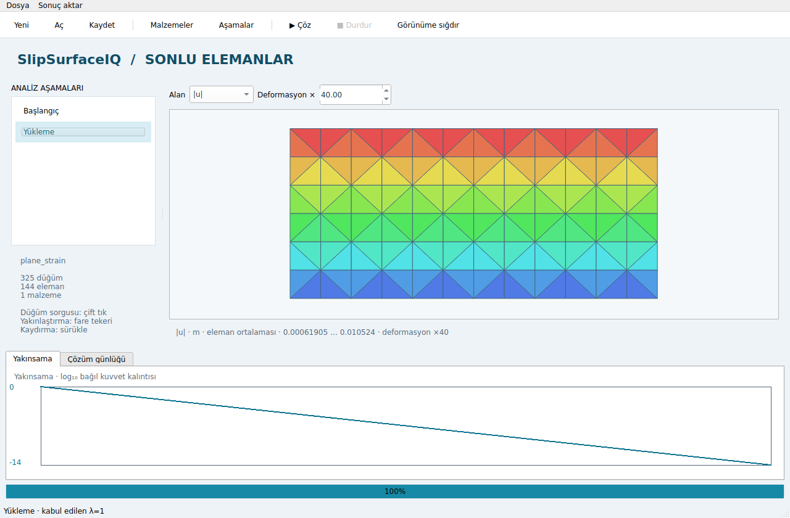

# Phase 5.1 — a running desktop start

This is the first Phase 5 delivery after Phase 4. It is a native **PySide6 / Qt Widgets**
application; it does not use a web server or a browser interface. **Gate 5 and v1.0 are not complete.**

Follow-on deliveries: [Phase 5.2 CAD, DXF, and mesh-from-drawing](phase5-cad.md),
[Phase 5.3 material/structure/load/water and stage builders](phase5-model-editors.md).

## Install and run

```bash
python -m pip install -r requirements.txt
python main.py
# Open an existing project:
python main.py model.ssproj
```



## What works in this delivery

- A native window, project open/save, and reading `.ssproj` and model JSON.
- A code-free rectangular T6 soil model: dimensions, mesh divisions, E/ν, and the top pressure.
  This builder is weightless, has no initial stress, and is a plane-strain model.
- Numerical constitutive parameters, unit weights, and the drainage type of the materials
  already in a loaded model; changes are applied after they are validated.
- Name, load-release ratio, drainage choice, active regions, and structures of the existing
  stages. Loads, water boundaries, and prescribed displacements are preserved.
- The same `api.run` engine on a separate Qt thread; stage progress, a convergence plot,
  a log, and controlled cancel. Cancel is checked between mechanical iterations and seepage
  Picard steps; an in-progress single factorisation/Numba call is not cut off instantly.
- Stage selection, the deformed mesh of the active elements, and nodal colour fields
  (u, stress components, principal stresses, q, plastic Gauss-point ratio, pore pressures).
  Rounding differences of a constant field are not turned into a colour change.
- Double-click queries the nearest active node and ux/uy; zoom/pan.
- Nodal CSV, raw beam-end N/V/M CSV, active-cell VTU, and a standalone HTML summary report.
  Nodal stresses in the CSV/VTU export are recovered with SPR. Colours on screen are the
  mean of the element-nodal extrapolation (a material jump is kept; the tooltip shows the
  nodal range). The query line is entered in undeformed coordinates and drawn on the
  deformed mesh.

When a model is edited, or a new solve is started, the previous result is cleared.
A failed or cancelled run does not produce a result or a success label. The run input is
copied before the start; editing and file operations are closed during the solve.
The window does not forcibly destroy a running thread; it asks for a controlled cancel first.

## Record compatibility

The main branch and PR #1 had developed different HDF5/.ssproj schemas. Both are kept:

- Preferred API: `save_project(model, path, results)`; `load_project(path)` recognises the format.
- The previous `save_project(path, model, results)` call and `io.ssproj` are supported.
- `save_results` / `ResultsReader` is the self-contained snapshot schema that includes the model.
- `write_results` / `ResultsFile` / `read_results(path, model)` is the older schema.
- In both schemas the seepage load/discharge, excess pore pressure, and step diagnostics are kept.
- The files are post-processing snapshots; they are not a nonlinear restart file.

`open_project_results` belongs to the older `.ssproj` format that has a manifest. The new
format uses `load_project`. Files without results also open.

## Phase 5 development status — publication stopped

The 22 October 2026 user review did not accept interface usability. Phase 5 is open; the
technical features below do not mean a finished user experience. [Open work](next-steps.md).

[Phase 5 version record](phase5-release.md): the timeline, mechanical-boundary and
displacement forms, interface create/property/delete, principal arrows and plastic Gauss
points, query lines, liner N–V–M plots, and GUI/API equality acceptance of the four-stage
tunnel built from an empty GUI were added. The portable (PyInstaller) package was removed:
the application now runs only with `python main.py`. Package-build workflows are also removed. Historical
CI evidence is kept separately in the version record.

Further CAD (DWG, curve/block DXF, a void that cuts a layer boundary, carrying existing FE
assignments across a remesh) is outside the supported linear CAD scope of v1.

`tests/unit/test_desktop.py` tests engine equality, project open/save, cancel, controls
after an error, and stage editing with a real Qt event loop and worker.
`tests/unit/test_progress_exports.py` checks active-cell/boundary-node recovery, CSV/VTU
NaN behaviour, record diagnostics, and the progress API.

Qt thread contract:
https://doc.qt.io/qtforpython-6.10/PySide6/QtCore/QThread.html
