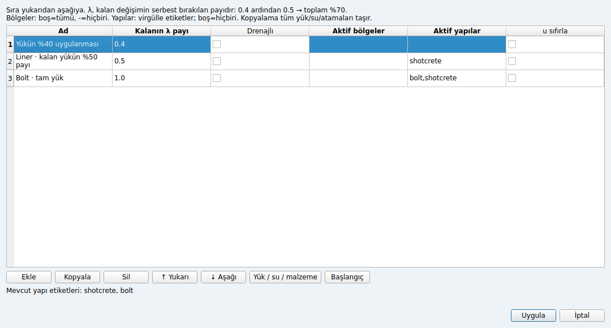

# Faz 5.3 — malzeme, yapı ve aşama kurucuları

Native Qt uygulamasında CAD ile üretilen veya projeden okunan ağ üzerinde yeni
malzeme, liner/bolt, yük, su ve sıralı yapım aşamaları oluşturulabilir. Bu teslim
Faz 5.2'nin devamıdır; **Kapı 5/v1.0 tamamlanmış değildir**.

## Kullanım

1. **Malzemeler:** Yeni / Düzenle / Kopyala / Sil; sağ tabloda her ağ bölgesine
   malzeme atayın. Elastic, Mohr–Coulomb, Hoek–Brown, MCC, Drucker–Prager ve von Mises
   formları bünye parametrelerini, γ/γsat, drenaj A/B/C, kx/ky ve van Genuchten
   özelliklerini destekler. Gösterilen yeni malzeme değerleri yalnız örnek başlangıç
   değerleridir. DP eşleştirmesi ve MC Rankine-apex seçeneği açık alanlardır.
   Malzeme adı değişince bölge ve aşama referansları birlikte güncellenir; kullanılan
   malzeme silinemez.
2. **Yapılar:** İsimli ağ kenarlarında liner veya tam bağlı bolt; iki mevcut ağ
   düğümü arasında uçtan ankrajlı bolt ekleyin. CAD bölgesi/çizgisi adları kenar
   kümesi olarak kullanılabilir. Liner kesiti metre düzlem dışı genişlik başınadır;
   bolt EA ve akma kuvveti tek bolt içindir, düzlem dışı aralıkla eşdeğerlenir.
   Akmayı aşan öngerme, mevcut motor davranışına uygun olarak kurulumda akma
   kuvvetine kesilir. Yeni yapılar pasiftir; aşamada ayrıca etkinleştirilmelidir.
   Özellik düzenlemesi bağlantıyı korur. Silme, başlangıç/aşama aktivasyon
   referanslarını da temizler.
3. **Aşamalar → Başlangıç:** Gerilmesiz, ağırlık çözümü, K₀ veya sabit gerilme alanı;
   aktif bölge/yapı ve başlangıç suyu. K₀ yatay tabakalanma içindir. Sabit alan
   `(σxx, σyy, σzz, τxy)` kPa cinsinden, basınç negatiftir. Yapılar alanında `auto`,
   mevcut ara yüzleri etkinleştirip liner/boltları pasif bırakır; boş değer açıkça
   hiçbir yapıyı etkinleştirmez.
4. **Aşamalar:** Ekle, Kopyala, Sil, Yukarı/Aşağı. Bölge alanında boş=tümü,
   `-`=hiçbiri; diğer değerler virgülle bölge numaralarıdır. Yapı alanı virgülle
   etiketlerdir, boş=hiçbiri. Drenajlı çözüm ve yer değiştirme sıfırlama ayrı
   seçeneklerdir. Her aşama benzersiz ve boş olmayan bir ad gerektirir.
5. **Yük / su / malzeme:** Kenar basıncı/teğetsel yük, global nokta kuvvetleri;
   susuz/piyezometrik çizgi/durağan sızma; aşamaya özel bölge malzemesi.
   Sızma için toplam hidrolik yük `h` (m), içeri pozitif akı (m/s), olası sızma
   yüzleri girilir. Piyezometrik çizgi her satırda `x h` ister; tek nokta yatay
   seviye, aynı x'te iki nokta geçersizdir. Başlangıç suyu ayrı düzenlenir.

**λ, kalan değişimin payıdır:** 0.4 ardından 0.5, toplam %70 serbest bırakır;
sonraki 1.0 kalanı tamamlar. Yük, su, aktif yapılar ve malzeme değişimi her aşamanın
kendi toplam tanımıdır; boş alanlar önceki aşamadan örtük devralınmaz. Devam eden
koşulları taşımak için **Kopyala** kullanın. Mevcut zorlanmış yer değiştirmeler
korunur; bu teslimde onlar için yeni bir düzenleyici eklenmedi.

Alt formda Uygula, ana düzenleyicinin taslağını günceller. Ana düzenleyicide
**Uygula** modele aktarır; **İptal** kaynak modeli değiştirmez. Uygulanan değişiklik
eski çözüm sonuçlarını temizler. Çözüm sırasında düzenleyiciler kapalıdır.

## Düzeltilen doğrulama eksikleri

- NaN/sonsuz yük, hidrolik yük, akı, başlangıç gerilmesi ve zorlanmış yer değiştirme
  bileşenleri çözümden önce reddedilir.
- Aynı x'te yinelenen piyezometrik noktalar belirsiz interpolasyona bırakılmaz.
- Başlangıç sızmasının küme referansları ve aktif bölgeleri kontrol edilir.
  Hidrolik yük sınırı gerçekten düğüm kümesi ister; yalnız kenar adı yeterli değildir.
- Olmayan bölgeye aşama malzemesi atama reddedilir.
- Birim ağırlık, liner kesiti/rijitliği, bolt rijitliği/akması/aralığı için sonlu
  ve fiziksel aralık kontrolleri eklenmiştir. S2'nin akma üstü öngerme davranışı korunur.
- Eski aşama formunda boş aktif bölge kümesi “tüm bölgeler”e dönüşebiliyordu;
  artık açık `-` gösterimiyle doğru biçimde saklanır.

## Kabul ve sınırlar

Tam yerel regresyon: **463 geçti, 1 strict xfail, 2 benchmark hariç** (105.40 s).
Ruff kontrolü başarılı.

`test_model_editors.py` gerçek Qt kontrolleriyle altı malzeme formunu, yeniden
adlandırma/atama/iptali, yük satırı silindikten sonraki tür değişimini, su
koşullarını, başlangıcı ve aşama kopyalama/sıralamayı doğrular. Liner ve iki bolt
türü oluşturma, bağlantı koruma ve silmenin aktivasyonları temizlemesi testlidir.

Uçtan uca kabul: formlarla kurulan dikdörtgen zemin modeli → %40 yük → liner ve
kalan yükün %50'si → bolt ve tam yük. Gerçek Qt çözüm işçisinin her aşamadaki
u/gerilme ve liner/bolt kuvvetleri bağımsız API tanımıyla eşleşir; proje
kaydetme/açma da kontrol edilir. **Bu test özgün dört aşamalı tünel kabulünün
yerini almaz.** Çekirdek girdi hataları ayrıca Qt gerektirmeyen
`test_authoring_validation.py` içinde kapsanır.

Kalanlar: ara yüz ekleme/silme formu, mevcut ağın mekanik sınır/yer değiştirme
koşulu düzenleyicisi, yeniden ağlamada FE atamalarını koruma, grafik zaman çizelgesi,
özgün tünelin sıfırdan kodsuz kabulü, asal gerilme/plastik nokta/sorgu çizgisi ve
liner N–V–M grafikleri, Windows portable ve yayın. CAD yeniden ağlaması hâlâ yeni
tek malzemeli elastik model oluşturur. S4 dış karşılaştırması ertelenmiştir;
eski kesmesiz P4 strict xfail olarak korunur.
