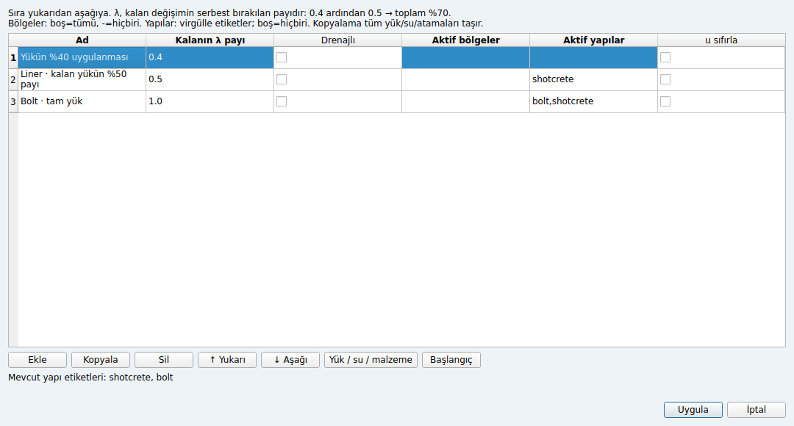

# Phase 5.3 — material, structure, and stage builders

On a mesh produced by CAD or read from a project, the native Qt application can create
new materials, liners/bolts, loads, water, and ordered construction stages. This delivery
continues Phase 5.2; **Gate 5/v1.0 is not complete**.

## Use

1. **Materials:** New / Edit / Copy / Delete; in the table on the right, assign a
   material to every mesh region. The elastic, Mohr–Coulomb, Hoek–Brown, MCC, Drucker–Prager,
   and von Mises forms support the constitutive parameters, γ/γsat, drainage A/B/C, kx/ky,
   and van Genuchten properties. The new material values that are shown are only sample
   starting values. The DP match and the MC Rankine-apex option are explicit fields.
   When a material is renamed, region and stage references are updated together; a material
   that is in use cannot be deleted.
2. **Structures:** a liner or a fully bonded bolt on a named mesh edge; add an end-anchored
   bolt between two existing mesh nodes. CAD region/line names can be used as edge sets.
   The liner section is per metre of out-of-plane width; bolt EA and the yield force are
   for a single bolt and are smeared by the out-of-plane spacing. A pretension above yield
   is cut to the yield force at installation, matching the current engine behaviour. New
   structures are passive; they must also be activated in a stage. Editing properties keeps
   the connectivity. Deletion also clears the initial/stage activation references.
3. **Stages → Initial:** stress-free, a gravity solve, K₀, or a constant stress field;
   active regions/structures and the initial water. K₀ is for horizontal layering. The
   constant field is `(σxx, σyy, σzz, τxy)` in kPa, with compression negative. In the
   structures field, `auto` activates the existing interfaces and leaves liners/bolts
   passive; an empty value explicitly activates no structure.
4. **Stages:** Add, Copy, Delete, Up/Down. In the region field, empty = all,
   `-` = none; other values are region numbers separated by commas. The structure field
   is comma-separated labels, empty = none. A drained solve and displacement reset are
   separate options. Every stage needs a unique, non-empty name.
5. **Load / water / material:** edge pressure/tangential load, global point forces;
   dry / piezometric line / steady seepage; a stage-specific region material.
   For seepage, enter the total hydraulic head `h` (m), the inward-positive flux (m/s),
   and the possible seepage faces. The piezometric line wants `x h` on each row; a single
   point is a horizontal level, and two points at the same x are invalid. Initial water
   is edited separately.

**λ is the fraction of the remaining change:** 0.4 followed by 0.5 releases 70% in total;
a following 1.0 completes the remainder. Load, water, active structures, and a material
change are each stage’s own total definition; empty fields are not inherited implicitly
from the previous stage. Use **Copy** to carry conditions forward. Existing prescribed
displacements are kept; this delivery did not add a new editor for them.

Apply on a sub-form updates the draft of the main editor. **Apply** on the main editor
writes it to the model; **Cancel** does not change the source model. An applied change
clears the old solution results. Editors are closed during a solve.

## Validation gaps that were fixed

- NaN/infinite load, hydraulic head, flux, initial stress, and prescribed-displacement
  components are rejected before the solve.
- Repeated piezometric points at the same x are not left to an ambiguous interpolation.
- The set references and active regions of the initial seepage are checked.
  A hydraulic-head boundary really requires a node set; an edge name alone is not enough.
- Assigning a stage material to a region that does not exist is rejected.
- Finite and physical range checks were added for unit weight, liner section/stiffness,
  and bolt stiffness/yield/spacing. The S2 pretension-above-yield behaviour is kept.
- In the old stage form an empty active-region set could become “all regions”;
  it is now stored correctly with an explicit `-`.

## Acceptance and limits

Full local regression: **463 passed, 1 strict xfail, 2 benchmarks excluded** (105.40 s).
The Ruff check passed.

`test_model_editors.py` checks the six material forms, rename/assign/cancel, the type
change after a load row is deleted, water conditions, the initial state, and stage
copy/reorder with real Qt controls. Creating a liner and both bolt types, preserving
connectivity, and deletion clearing activations are tested.

End-to-end acceptance: a rectangular soil model built from the forms → 40% of the load
→ the liner and 50% of the remaining load → the bolt and the full load. The u/stress
and liner/bolt forces of the real Qt solve worker at every stage match an independent
API definition; project save/open is also checked. **This test does not replace
acceptance of the original four-stage tunnel.** Core input errors are also covered in
`test_authoring_validation.py`, which does not need Qt.

Still remaining: an interface add/delete form, an editor for the mechanical boundary /
displacement condition of the existing mesh, preserving FE assignments on remesh, a
graphical timeline, code-free acceptance of the original tunnel from scratch, principal-stress /
plastic-point / query-line and liner N–V–M plots, the Windows portable build, and publication.
CAD remeshing still creates a new single-material elastic model. The S4 external comparison
was deferred; the legacy P4 without a tension cut-off is kept as a strict xfail.
