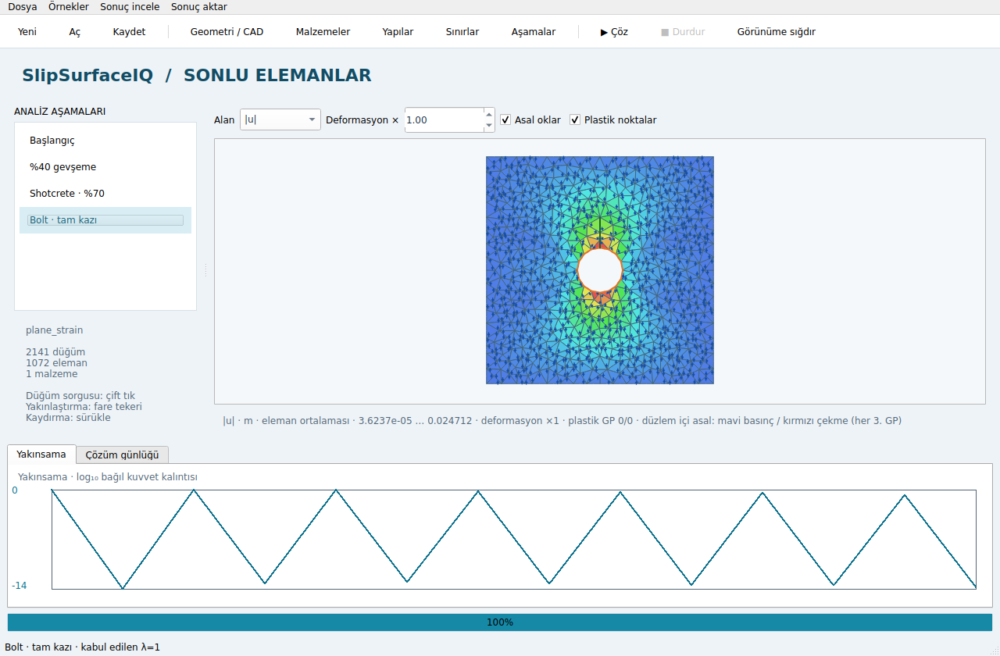
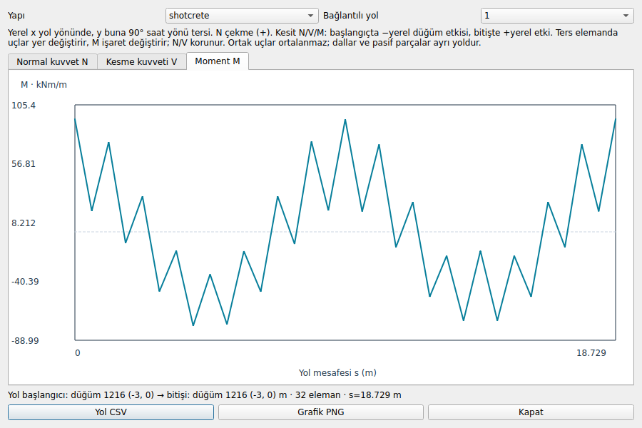

# Faz 5 — yayın geri çekildi, paket sürümü 0.9.0

**22 Ekim 2026: Kullanıcı arayüzü kullanışlı bulmadı; v1.0.0 hazır kabul edilmiyor.**
GitHub release listesi boş; v1.0.0 yayını kaldırılmış durumda. Paket bilinçli olarak
**0.9.0**'dır. Otomatik paket yayını ve PyPI yükleme adımı durduruldu. Aşağıdaki
sonuçlar tarihsel teknik test kanıtıdır; kullanıcı kabulü veya Faz 5 kapanışı
anlamına gelmez.

Öncelik: Windows tema/kontrast sorunları, görünmeyen araç yazıları, panel
yerleşimi ve anlaşılır modelleme akışı. Kullanıcı kabulünden sonra yeni yayın
ayrıca değerlendirilecek. [Açık işler](next-steps.md).

Native PySide6 masaüstü: CAD/DXF → T6 ağ; malzeme/bölge, liner/bolt/ara yüz,
mekanik sınır ve aşama su/yük/yer değiştirme düzenleyicileri; aşama zaman çizelgesi;
arka plan çözüm/iptal; kontur, deforme ağ, plastik GP ve düzlem içi asal oklar;
sorgu çizgileri ve yönü tanımlı liner N–V–M grafikleri; proje/CSV/VTU/HTML kaydı.

## Otomatik GUI/API eşitlik testi — kullanıcı kabulü değil

`test_phase5_acceptance.py` boş CAD formundan 16 kenarlı dairesel tünel yaklaşımı,
çevre kaya bölgesi ve taç bolt çizgisini oluşturur. Gerilme başlangıcı → %40
gevşeme → shotcrete ile toplam %70 → bolt ve kalan kazının tamamlanması.
GUI işçisi ve bağımsız Domain/API modelinin bütün aşamalarında u, gerilme,
liner/bolt kuvveti, plastik bayrak, su ve aktivasyon dizileri birebir eşleşir.
Kazı boşluğundaki sorgular NaN kalır; kaydedilen proje yeniden açılır.

Bu bir GUI/API eşitlik kabulüdür; bağımsız tünel doğrulamasının yerine geçmez.
S1–S3 ve diğer mevcut analitik doğrulamalar ayrı CI testleridir.

Yerel tam regresyon: **472 geçti, 1 strict xfail, 2 benchmark hariç** (108.27 s).
Kaynak smoke kontrolü dört durum, kayıt, DXF, dışa aktarım ve Numba ile başarılı.
[JUnit'ten üretilen doğrulama dökümü](phase5-verification.md) xfail'i başarı saymaz.
Linux/Windows, Python 3.10–3.13 ve iki native GUI işi: **10/10 başarılı**
([CI kanıtı](https://github.com/hdaltuntas/SlipSurfaceIQ-FEA/actions/runs/39674914899)).

## Sayısal ve kullanım sınırları

- S4'ün RS2/PLAXIS karşılaştırması yoktur. İç Winkler uyumu bu boşluğu kapatmaz.
- Eski kesmesiz P4 strict xfail olarak korunur. Yerel bünye dönüş hatası fiziksel
  göçme kanıtı veya SRF üst sınırı sayılmaz. Açık Rankine-apex akışı ayrı seçenektir.
- Çizgisel 2B DXF desteği vardır; DWG ve eğri/blok DXF bu sürüme dahil değildir.
- CAD yeniden ağlaması mevcut FE tanımlarını adla eşleyerek aktarır; hedefi kalmayanlar
  çözüm günlüğünde listelenir ([ayrıntı](integrated-modeler.md)).
- Sonuç konturları eleman ortalamasıdır. Sorgu çizgisi gerilmeleri eleman içinde GP
  ekstrapolasyonuyla hesaplanır; malzeme sınırında taraf için bölge filtresi vardır.
- Asal oklar düzlem içi iki gerilmeyi gösterir; szz ile sıralanmış 3B asal değerler
  kontur alanlarında ayrıdır. Plastik nokta/ok sayısı büyük modelde seyreltilirse
  ekranda gösterilir. Sorgu çizgisi deforme olmamış koordinatları kullanır.
- Liner yerel x yol yönündedir, yerel y 90° saat yönü tersidir. N çekme pozitiftir.
  N/V/M başlangıçta eksi yerel düğüm etkisi, bitişte artı yerel etkidir. Yol tersine
  dönen elemanda uç sırası ters çevrilir ve M işareti değişir. Ortak uçlar ortalanmaz.
- Ara yüz silme çakışan eş düğümleri birleştirir; başka bir ara yüzü tamamen
  kapatacak silme reddedilir. Kullanılmayan düğüm kimlikleri korunur.
- Liner plastisitesi, dinamik analiz ve tam konsolidasyon v1 kapsamı dışındadır.

## Paket ve yayın

Portable (PyInstaller onedir) paket kaldırıldı: `packaging/` ve `.github/workflows/portable.yml`
silindi. Uygulama yalnızca `python main.py` ile çalışır. Wheel/sdist yine de üretilir ve
`scripts/check_distributions.py` ile denetlenir.

İlk bağımsız Windows paket testi **başarılı**:
[`39674915048`](https://github.com/hdaltuntas/SlipSurfaceIQ-FEA/actions/runs/39674915048),
`5c4dcb8`; `frozen=true`, `numba_enabled=true`, 2141 düğüm, dört durum,
maksimum yer değiştirme 0.02792259577890792 m. Paket içindeki NumPy kullanıldı.
Yayın öncesi incelemede sdist'e derleme ortamının eklenmesi giderildi; kaynak paket
beyaz listeyle sınırlandı. Her derleme dosya içeriğini ve 20 MB boyut sınırını denetler.

PyPI denemesi `invalid-publisher` ile başarısız oldu; başarılı bir PyPI yayını yok.
`publish.yml` artık yalnızca elle çağrılan paket kontrolüdür: PyPI yükleme işi,
OIDC yetkisi ve release tetikleyicisi kaldırıldı; `portable.yml` de kaldırıldı.
GitHub release oluşturulmaz veya dosya yüklenmez.
