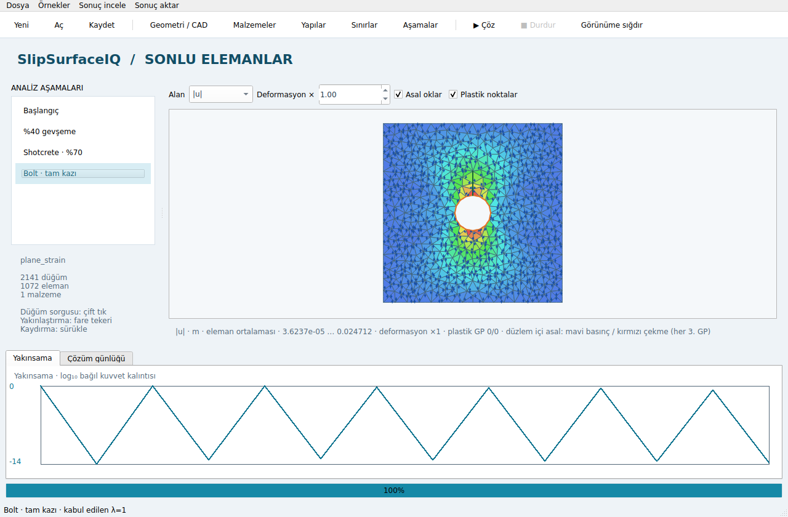
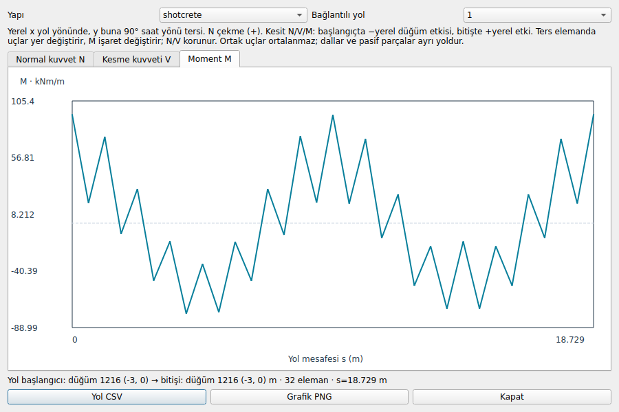

# Phase 5 — 0.9.0 release candidate, Windows acceptance still open

**22 October 2026:** the earlier v1.0.0 release was withdrawn after the user found the
desktop interface unusable. The release list remains empty and the package is deliberately
**0.9.0**. The identified contrast, workflow-layout and remesh issues were subsequently
corrected; automated GUI/API checks and the external benchmark gates now pass.

Phase 5 is still open because a real Windows end-to-end usability acceptance has not yet
been recorded. Automated/offscreen tests do not substitute for that acceptance.
[Release readiness](release-1.0-readiness.md) · [Open work](next-steps.md).

Native PySide6 desktop: CAD/DXF → T6 mesh; material/region, liner/bolt/interface,
mechanical boundary, and stage water/load/displacement editors; a stage timeline;
background solve/cancel; contours, the deformed mesh, plastic Gauss points, and in-plane
principal arrows; query lines and oriented liner N–V–M plots; project/CSV/VTU/HTML save.

## Automated GUI/API equality test — not user acceptance

`test_phase5_acceptance.py` builds a 16-sided circular tunnel approximation, the
surrounding rock region, and the crown bolt line from an empty CAD form. Initial stress
→ 40% relaxation → shotcrete to a total of 70% → completion of the bolt and the
remaining excavation. Across every stage, u, stress, liner/bolt forces, the plastic
flag, water, and the activation sequences of the GUI worker and of the independent
Domain/API model match exactly. Queries inside the excavation void stay NaN; the saved
project opens again.

This is a GUI/API equality acceptance; it does not replace an independent tunnel
verification. S1–S3 and the other existing analytical verifications are separate CI tests.

Local full regression: **472 passed, 1 strict xfail, 2 benchmarks excluded** (108.27 s).
The source smoke check succeeded for four states, save, DXF, export, and Numba.
The [verification dump generated from JUnit](phase5-verification.md) does not count the xfail as a pass.
Linux/Windows, Python 3.10–3.13, and two native GUI jobs: **10/10 passed**
([CI evidence](https://github.com/hdaltuntas/SlipSurfaceIQ-FEA/actions/runs/39674914899)).

## Current external validation gates

The v1 release candidate now uses four strict independent benchmark gates:

- **B1 RS2 Introduction / Surface Excavation** — published staged-displacement targets;
- **B2 PLAXIS Tutorial 01A** — rigid circular footing reaction and settlement;
- **B3 PLAXIS phi-c reduction / Bishop** — safety-factor and mesh-convergence checks;
- **B4 PLAXIS Drain / Dupuit** — groundwater discharge, head and mass-balance checks.

Each is run with `--require-pass` in CI. These benchmarks support only their stated
feature domains; they are not a claim of global RS2/PLAXIS equivalence. The exact custom
S4 sheet-pile comparison remains open advanced validation and is not silently counted
as passed.

## Numerical and usage limits

- There is no RS2/PLAXIS comparison for S4. Internal Winkler agreement does not close that gap.
- The legacy P4 without a tension cut-off is kept as a strict xfail. A local constitutive
  return error is not counted as proof of physical collapse or as an SRF upper bound.
  Explicit Rankine-apex flow is a separate option.
- Linear 2D DXF is supported; DWG and curve/block DXF are not included in this version.
- CAD remeshing transfers existing FE definitions by name; those with no remaining target
  are listed in the solution log ([detail](integrated-modeler.md)).
- Result colours are the mean of the element-nodal values (displacement at the nodes;
  stress and pore pressure extrapolated from the Gauss points). Nodes are not averaged
  across materials, so a jump is kept. The tooltip shows the nodal range in the element.
  Query-line stresses use the same in-element extrapolation; a region filter selects the
  side at a material boundary. The query is entered in undeformed coordinates and drawn
  on the deformed mesh.
- The plastic contour is the element-wise fraction of Gauss points with a non-elastic
  state (0–1). Shear, tension and apex flags all count as yielding; categorical codes
  are not extrapolated. Query overlays break wherever samples have no active data.
- Structure displacement charts and deformed N–V–M overlays retain element node IDs;
  coincident nodes on opposite interface faces keep their own displacement values.
- Principal arrows show the two in-plane stresses; the 3D principal values ordered with
  szz are separate contour fields. If the number of plastic points/arrows is thinned on a
  large model, that is shown on screen.
- Liner local x is along the path; local y is 90° counterclockwise. N is positive in tension.
  N/V/M is the negative local nodal action at the start and the positive local action at
  the end. On an element whose path reverses, the end order is reversed and the sign of M
  changes. Shared ends are not averaged.
- Deleting an interface merges coincident paired nodes; a deletion that would completely
  close another interface is rejected. Unused node ids are kept.
- Liner plasticity, dynamic analysis, and full consolidation are outside the v1 scope.

## Package and publication

**2 November 2026: source-only operation requested by the user.**

Run `python -m pip install -r requirements.txt`, then `python main.py`.
There is no native installer/portable build, wheel/sdist build workflow or publishing
workflow. The remaining manual `publish.yml` package check and its helper were removed.
The installed console entry point and `python -m slipsurface.fe2d.gui` launcher were
also removed. CI installs dependencies and tests the source checkout directly.

The following is historical evidence only: the first independent Windows portable
test passed ([39674915048](https://github.com/hdaltuntas/SlipSurfaceIQ-FEA/actions/runs/39674915048),
`5c4dcb8`; 2141 nodes, four states). The earlier PyPI attempt failed with
`invalid-publisher`; there was no successful PyPI publication.
No new release or package is produced by this change.
