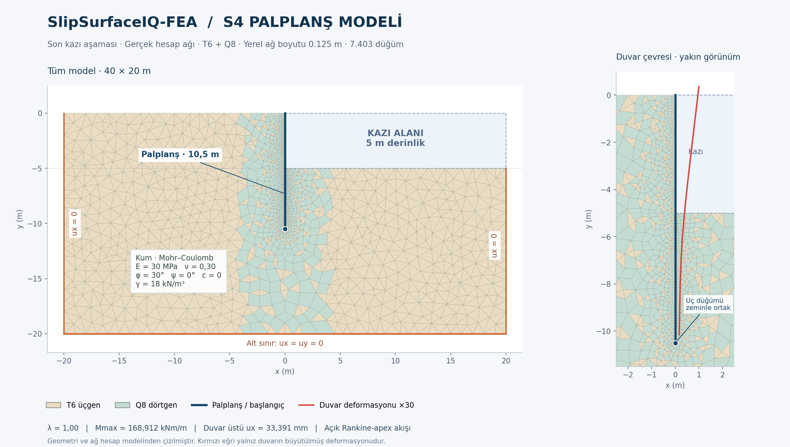
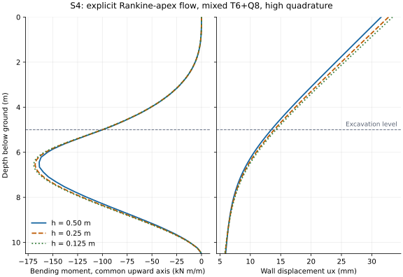

# S4 — sürekli ortam palplanş karşılaştırması

Bu protokol açık `rankine_at_apex=True` modeli için aynı girdilerle bağımsız çözüm
alınmasını sağlar. **Dış karşılaştırma yapılmadı.** S4/Kapı 3 dış doğrulama ölçütü
geçmedi. Tablo biçimi [s4-external.md](s4-external.md). Paket içindeki
SlipSurfaceIQ-FEA koşuları dış referans olarak kullanılamaz.

## Sabit fiziksel problem

| Girdi | Değer |
|---|---|
| Analiz / birimler | Küçük şekil değiştirme, düzlem şekil değiştirme, 1 m genişlik; m, kN, kPa |
| Alan | −20≤x≤20 m, −20≤y≤0 m |
| Palplanş | x=0, −10.5≤y≤0 m; üst serbest, uçta zeminle ortak öteleme, dönme serbest |
| Kazı | 0≤x≤20 m, −5≤y≤0 m; sağ taraf, su ve sürşarj yok |
| Zemin | MC ideal plastisite: E=30000 kPa, ν=0.30, c=0, φ=30°, ψ=0, γ=18 kN/m³ |
| Çekme akışı | Açık ilişkili Rankine, σt=MC apex=0 kPa |
| Başlangıç | σyy=18y, σxx=σzz=0.5σyy, τxy=0; çekme pozitif |
| Duvar | E=2×10⁸ kPa, ν=0, A=0.1 m²/m, I=0.001 m⁴/m, As=0.08 m²/m; ağırlıksız |
| Rijitlikler | EA=2×10⁷ kN/m, EI=2×10⁵ kN·m²/m, GA=8×10⁶ kN/m |
| İki taraflı Goodman | kn=403846.153846 kPa/m, ks=115384.615385 kPa/m; ci=0, φi=30°, ψi=0, σti=0 |
| Sınırlar | Altta ux=uy=0; x=±20 m yanlarda ux=0; duvar boyunca ara yüz, uçta ortak düğüm |
| Aşamalar | K0 alanı ve başlangıç ara yüz çekmeleri → kuvvetsiz duvar kurulumu → kazı yükünün tam serbest bırakılması |

Duvar kurulumu kazık çakma/deplasman etkilerini modellemez. Kazıda sağdaki ara yüzün
zeminsiz kalan elemanları devre dışı kalır. Ara yüz rijitlikleri R=1 ve sanal
kalınlık 0.1 m'den gelir; başka yazılımın varsayılan penalty değeri kullanılmamalıdır.
Bu model Timoshenko kiriş–Winkler ve ideal Rankine basınç testlerinden farklıdır.

Mevcut ağdaki uç davranışı ayrıca eşleştirilmelidir: (0, −10.5) m'de duvar ile
zemin aynı öteleme düğümünü kullanır; `pile_left` ara yüzünün iki yüzü o noktada
birleşir. `pile_right` ara yüzü de aynı uç düğümünde kapanır. Bu, zemine bağlanan
uç ötelemesi demektir; ankastre veya bütünüyle bağımsız serbest uç değildir.
`case.json` ortak noktaları ve kapanan ara yüz uçlarını gerçek bağlantı dizilerinden
çıkarır. Dış programda başka uç idealizasyonu seçilirse aynı problem çözülmüş olmaz.

Önceki kod ilk ara yüz kesitini dış sınır gibi sayıyor, ikinci eklemede iç ucu
ayırıyordu. `boundary_nodes(..., join_interfaces=True)` artık yalnız mevcut ara yüz
elemanlarında açıkça eşleştirilmiş düğümleri sınır sorgusu için özdeş kabul eder.
Hesap düğümleri birleştirilmez; yalnız dış sınır/iç uç sınıflaması düzeltilir.
Gerilme toparlama için kullanılan varsayılan sınır sorgusu ara yüz yüzlerini ayrı
tutmaya devam eder. Sol→sağ ve sağ→sol ekleme aynı iç uç bağlantısını üretir.

Bu hatayı gösteren 10 yeni test önceki kodda başarısızdı; düzeltmeyle geçer.
Sekiz test T3/T6/Q4/Q8 ve tek/çift iç ucu, iki test farklı rijitlikli iki zemin
yanında deplasman, duvar kesit kuvvetleri ve reaksiyon dengesini kontrol eder.
Önceki asimetrik uçlu sayısal kayıtlar [5f0c4eb](https://github.com/hdaltuntas/SlipSurfaceIQ-FEA/tree/5f0c4eba64b1ad72ad01f9d8db52eace9f31446f/docs/data/s4)
commit'inde korunur; aşağıdaki güncel değerlerle aynı uç bağlantısına sahip değildir.

## Tekrar ve aktarım

```bash
PYTHONPATH=src OPENBLAS_NUM_THREADS=1 python examples/verify_sheet_pile.py --mixed --study --output /tmp/s4-study
PYTHONPATH=src OPENBLAS_NUM_THREADS=1 python examples/verify_sheet_pile.py --mixed --size 0.25 --output /tmp/s4-h025
PYTHONPATH=src OPENBLAS_NUM_THREADS=1 python examples/verify_sheet_pile.py --mixed --size 0.125 --output /tmp/s4-h0125
PYTHONPATH=src OPENBLAS_NUM_THREADS=1 python examples/verify_sheet_pile.py --mixed --reverse-interface-order --output /tmp/s4-right-first
```

Araç her koşu için yeni bir dizin ister; başarısız tekrar eski başarılı dosyaları
kullanamaz. `--save-project` tam sonuç snapshot'ını `.ssproj` olarak da kaydeder.

- `case.json`: geometri, malzeme, su, sınırlar, ara yüz ve fiziksel aşamalar. Sayısal
  ayarlar/ağdan bağımsız SHA-256 özeti `summary.json` içindedir.
- `model.json`: tam ağ, bağlantılar, kümeler, parametreler ve çözüm ayarları; uygulamada
  `load_model` ile yeniden okunabilir.
- `wall-end-forces.csv`: her aktif kirişin iki ucunda derinlik, eleman/uç/düğüm kimliği,
  yerel yön ve imzalı N/V/M. Ortak düğümdeki iki değer **ortalanmaz**; tepe momenti
  veya kuvvet sıçramaları kaybolmaz.
- `wall-displacements.csv`: her aktif duvar düğümünde derinlik, ux, uy ve dönme.
  Duvar deplasmanı ile tüm ağın maksimum deplasman normu ayrı raporlanır.
- `summary.json`: yalnız tam çözümden sonra yazılır; λ, moment/derinlik, duvar
  deplasmanları, serbest DOF artık normu, iterasyon ve ret sayıları.
- `sensitivity.json`: aynı ağda adım yarılama ve iki aşamada serbest bırakma
  karşılaştırması; bir dış referans veya otomatik S4 geçiş belgesi değildir.

CSV'de derinlik `−y`, ux sağa, uy yukarı pozitiftir. Yerel eksen `node0→node1`,
enine yön `(−s,c)`; N çekmede pozitiftir. Uç kesit kuvveti birinci uçta `−T f`,
ikinci uçta `+T f` olarak verilir. Dış yazılımın işaretleri bu tanıma çevrilmelidir.
Moment kN·m/m, eksenel/kesme kuvveti kN/m, deplasman m ve dönme radyandır.
Düşey kirişlerin bağlantı yönü kazı kotunda ters dönebildiğinden, çizim ve dış
karşılaştırma için ortak yukarı yönlü eksende `M_up=local_s*M` sütunu da verilir.
Ham `M` değerlerini yön dönüşümü yapmadan birleştirmek yapay işaret sıçraması üretir.
Grafikte `M_up` kullanılır; maksimum mutlak moment bu dönüşümden etkilenmez.



## Kaydedilen sayısal duyarlılık

Tüm koşular high integrasyon, tam NR ve **sıfır** `apex_stiffness_ratio` ile λ=1'e
ulaştı; reddedilen adımlar arasında `material_return` yok. Son kabul edilen durumda
geçersiz 255 malzeme bayrağı yok. Sayısal veriler [data/s4/results.json](data/s4/results.json),
girdiler [data/s4/case.json](data/s4/case.json) içinde; bu kayıtlar bağımsız referans değildir.

| Yerel h (m), T6+Q8 | Düğüm | Maks. \|M\| (kN·m/m) | Moment derinliği (m) | Duvar üstü ux (mm) | Tüm ağ maks. \|u\| (mm) |
|---|---:|---:|---:|---:|---:|
| 0.50 | 3657 | 163.729759 | 6.437500 | 31.624986 | 39.747635 |
| 0.25 | 4916 | 168.058175 | 6.546875 | 32.793317 | 42.044490 |
| 0.125 | 7403 | 168.911600 | 6.546875 | 33.391392 | 43.230226 |

Ardışık tepe moment değişimleri %2.644 → %0.508; duvar ux maksimumunun değişimi
%3.6943 → %1.8238. Bu yerel inceltme dizisinde uzak alan boyutu 1.5 m'de sabittir;
alan sınırı duyarlılığı veya genel ağ bağımsızlığı sonucu çıkarılmaz.



Aynı h=0.5 m ağı üzerinde, başlangıç/azami yük adımı 0.1/0.5 yerine 0.05/0.25
seçildi. İki aşamalı serbest bırakma ayrıca standart adım ayarlarıyla çalıştırıldı.
Yüzde farkların paydası başlangıç koşusunun ilgili maksimum mutlak değeridir.

| Koşu | Maks. \|M\| (kN·m/m) | Tepe moment farkı | İmzalı M alanı farkı | Duvar ux alanı farkı |
|---|---:|---:|---:|---:|
| Standart adımlar | 163.729759 | — | — | — |
| Yarı adımlar | 163.785192 | %0.0339 | %0.0564 | %0.0783 |
| %50 + kalan serbest bırakma | 164.076680 | %0.2119 | %0.2735 | %0.3803 |

Bu duyarlılık koşularında tolerans gevşetilmedi veya duvar/zemin rijitliği ayarlanmadı.
S3'teki elastik kesin bölme değişmezliği testi ayrıca geçer; plastik sonuçlar yukarıdaki
sonlu farklarla raporlanır.

Ters ara yüz ekleme sırası (`h050-right-first`) aynı fiziksel girdi özetini,
aynı 3657 düğümü ve 59 iterasyonda λ=1 sonucunu üretir. Bağıl farklar tepe
momentinde 6.237e-13, imzalı moment alanında
9.825e-13, duvar ux alanında
8.002e-13; farklar yuvarlama düzeyindedir.

## Doğrulama ölçütü ve dış referans

Maksimum moment farkı, **bağımsız çözümün** maksimum mutlak momentine bölünerek
hesaplanır: `abs(M_FE,max − M_ref,max) / M_ref,max ≤ 0.10`. Aynı derinlik ekseninde
imzalı moment ve yatay deplasman alanları da incelenir. Dış yazılımın adı/sürümü,
model girdisi, ağ seviyesi, aşama ve yakınsama durumu sonuçla birlikte saklanmalıdır.
Girdi veya akış modeli farklıysa yüzde fark S4 geçişi olarak değerlendirilmez.

Yük adımı ve aşama bölme incelemesi aynı kazı yük yolunun sayısal duyarlılığını ölçer.
`split-release` önce %50 dengesiz kuvveti serbest bırakır, ardından kalan kısmı
tamamlar; iki ayrı derinlikte kazı değildir. Plastik yük yolu için elastik S3
testindeki makine hassasiyetinde eşitlik beklenmez. Tepe moment farkının yanı sıra
tüm imzalı moment ve duvar ux alanlarının maksimum farkları raporlanır.

Tam S4 için gereken eksik girdi: bu problemle eşleşen bağımsız program modeli ve
son kazı aşamasının moment/deplasman çıktısı. Bu dosyalar olmadan dış karşılaştırma
tamamlanmış sayılmaz.
