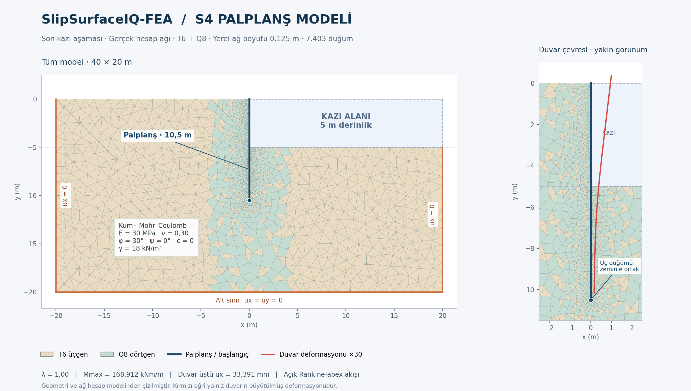
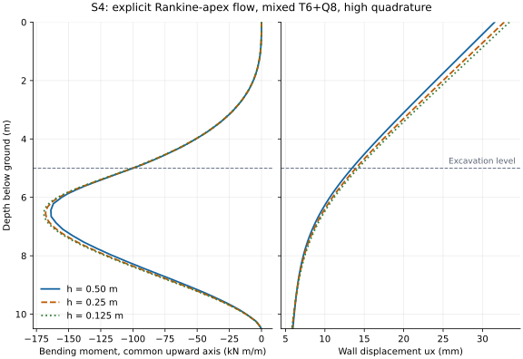

# S4 — continuum sheet-pile comparison

This protocol makes it possible to obtain an independent solution of the explicit
`rankine_at_apex=True` model with the same inputs. **The external comparison was not
done.** The S4/Gate 3 external verification criterion did not pass. The table format
is [s4-external.md](s4-external.md). SlipSurfaceIQ-FEA runs inside the package cannot
be used as the external reference.

## Fixed physical problem

| Input | Value |
|---|---|
| Analysis / units | Small strain, plane strain, 1 m width; m, kN, kPa |
| Domain | −20≤x≤20 m, −20≤y≤0 m |
| Sheet pile | x=0, −10.5≤y≤0 m; free at the top, translation shared with the soil at the tip, rotation free |
| Excavation | 0≤x≤20 m, −5≤y≤0 m; right-hand side, no water and no surcharge |
| Soil | Ideal MC plasticity: E=30000 kPa, ν=0.30, c=0, φ=30°, ψ=0, γ=18 kN/m³ |
| Tensile flow | Explicit associated Rankine, σt=MC apex=0 kPa |
| Initial | σyy=18y, σxx=σzz=0.5σyy, τxy=0; tension positive |
| Wall | E=2×10⁸ kPa, ν=0, A=0.1 m²/m, I=0.001 m⁴/m, As=0.08 m²/m; weightless |
| Stiffnesses | EA=2×10⁷ kN/m, EI=2×10⁵ kN·m²/m, GA=8×10⁶ kN/m |
| Two-sided Goodman | kn=403846.153846 kPa/m, ks=115384.615385 kPa/m; ci=0, φi=30°, ψi=0, σti=0 |
| Boundaries | ux=uy=0 at the bottom; ux=0 on the sides x=±20 m; interface along the wall, a shared node at the tip |
| Stages | K0 field and the initial interface tractions → installation of the force-free wall → full release of the excavation load |

Wall installation does not model pile driving/displacement effects. During excavation,
elements of the right-hand interface that no longer have soil are deactivated. The
interface stiffnesses come from R=1 and a virtual thickness of 0.1 m; another program’s
default penalty value must not be used. This model is different from the Timoshenko
beam–Winkler and ideal Rankine pressure tests.

The tip behaviour on the current mesh must be matched as well: at (0, −10.5) m the wall
and the soil use the same translation node; the two faces of the `pile_left` interface
meet at that point. The `pile_right` interface also closes on the same tip node. This
means tip translation tied to the soil; it is not a fixed end, and it is not a fully
independent free end. `case.json` extracts the shared points and the closed interface
ends from the real connectivity arrays. If another tip idealisation is chosen in the
external program, the same problem has not been solved.

The previous code treated the first interface section like an outer boundary and split
the inner tip on the second insertion. `boundary_nodes(..., join_interfaces=True)` now
treats as identical, for the boundary query only, nodes that are explicitly paired on
existing interface elements. Computational nodes are not merged; only the outer-boundary /
inner-tip classification is corrected. The default boundary query used for stress
recovery continues to keep the interface faces separate. Left→right and right→left
insertion produce the same inner-tip connection.

The 10 new tests that demonstrate this bug failed on the previous code; they pass with
the fix. Eight tests check T3/T6/Q4/Q8 and a single/double inner tip; two tests check
displacement, wall section forces, and reaction balance beside two soils of different
stiffness. The previous numerical records with an asymmetric tip are preserved at commit
[5f0c4eb](https://github.com/hdaltuntas/SlipSurfaceIQ-FEA/tree/5f0c4eba64b1ad72ad01f9d8db52eace9f31446f/docs/data/s4);
they do not have the same tip connection as the current values below.

## Replay and transfer

```bash
PYTHONPATH=src OPENBLAS_NUM_THREADS=1 python examples/verify_sheet_pile.py --mixed --study --output /tmp/s4-study
PYTHONPATH=src OPENBLAS_NUM_THREADS=1 python examples/verify_sheet_pile.py --mixed --size 0.25 --output /tmp/s4-h025
PYTHONPATH=src OPENBLAS_NUM_THREADS=1 python examples/verify_sheet_pile.py --mixed --size 0.125 --output /tmp/s4-h0125
PYTHONPATH=src OPENBLAS_NUM_THREADS=1 python examples/verify_sheet_pile.py --mixed --reverse-interface-order --output /tmp/s4-right-first
```

The tool requires a new directory for every run; a failed replay cannot use old
successful files. `--save-project` also saves the full result snapshot as `.ssproj`.

- `case.json`: geometry, materials, water, boundaries, the interface, and the physical
  stages. The SHA-256 digest that is independent of the numerical settings/mesh is in `summary.json`.
- `model.json`: the full mesh, connectivity, sets, parameters, and solver settings; it
  can be read back in the application with `load_model`.
- `wall-end-forces.csv`: depth, element/end/node id, local direction, and signed N/V/M
  at both ends of every active beam. The two values at a shared node are **not averaged**;
  a head moment or a force jump is not lost.
- `wall-displacements.csv`: depth, ux, uy, and rotation at every active wall node.
  The wall displacement and the maximum displacement norm of the whole mesh are reported separately.
- `summary.json`: written only after a complete solution; λ, moment/depth, wall
  displacements, the free-DOF residual norm, and the iteration and rejection counts.
- `sensitivity.json`: step halving and release in two stages on the same mesh; it is
  not an external reference or an automatic S4 pass document.

In the CSV, depth is `−y`, ux is positive to the right, and uy is positive upward.
The local axis is `node0→node1`, the transverse direction is `(−s,c)`; N is positive
in tension. The end section force is given as `−T f` at the first end and `+T f` at
the second end. The signs of an external program must be converted to this definition.
Moment is kN·m/m, axial/shear force is kN/m, displacement is m, and rotation is radians.
Because the connectivity direction of vertical beams can reverse at the excavation
level, an `M_up=local_s*M` column is also given in a common upward axis for plotting
and for the external comparison. Joining the raw `M` values without a direction
conversion produces an artificial sign jump. The plot uses `M_up`; the maximum absolute
moment is not affected by this conversion.



## Recorded numerical sensitivity

Every run reached λ=1 with high integration, full NR, and an `apex_stiffness_ratio` of
**zero**; there is no `material_return` among the rejected steps. The last accepted
state has no invalid 255 material flag. The numerical data are in
[data/s4/results.json](data/s4/results.json) and the inputs in
[data/s4/case.json](data/s4/case.json); these records are not an independent reference.

| Local h (m), T6+Q8 | Nodes | Max. \|M\| (kN·m/m) | Moment depth (m) | Wall-head ux (mm) | Whole-mesh max. \|u\| (mm) |
|---|---:|---:|---:|---:|---:|
| 0.50 | 3657 | 163.729759 | 6.437500 | 31.624986 | 39.747635 |
| 0.25 | 4916 | 168.058175 | 6.546875 | 32.793317 | 42.044490 |
| 0.125 | 7403 | 168.911600 | 6.546875 | 33.391392 | 43.230226 |

Successive peak-moment changes are 2.644% → 0.508%; the change of the maximum wall ux
is 3.6943% → 1.8238%. In this local refinement series the far-field size is fixed at
1.5 m; no conclusion is drawn about domain-boundary sensitivity or general mesh independence.



On the same h=0.5 m mesh, the initial/maximum load step was set to 0.05/0.25 instead
of 0.1/0.5. Release in two stages was also run with the standard step settings.
The denominator of the percentage differences is the corresponding maximum absolute
value of the initial run.

| Run | Max. \|M\| (kN·m/m) | Peak moment difference | Signed M field difference | Wall ux field difference |
|---|---:|---:|---:|---:|
| Standard steps | 163.729759 | — | — | — |
| Half steps | 163.785192 | 0.0339% | 0.0564% | 0.0783% |
| 50% + remaining release | 164.076680 | 0.2119% | 0.2735% | 0.3803% |

In these sensitivity runs the tolerance was not relaxed and the wall/soil stiffness was
not adjusted. The elastic exact split-invariance test in S3 also passes; plastic results
are reported with the finite differences above.

Reverse interface insertion order (`h050-right-first`) produces the same physical-input
digest, the same 3657 nodes, and a λ=1 result in 59 iterations. The relative differences
are 6.237e-13 in the peak moment, 9.825e-13 in the signed moment field, and 8.002e-13
in the wall ux field; the differences are at rounding level.

## Verification criterion and the external reference

The maximum-moment difference is computed by dividing by the maximum absolute moment of
the **independent solution**: `abs(M_FE,max − M_ref,max) / M_ref,max ≤ 0.10`. The signed
moment and the horizontal-displacement fields are also examined on the same depth axis.
The name/version of the external program, the model input, the mesh level, the stage,
and the convergence status must be stored together with the result. If the input or the
flow model differs, the percentage difference is not assessed as an S4 pass.

The load-step and stage-split study measures the numerical sensitivity of the same
excavation load path. `split-release` first releases 50% of the unbalanced force and
then completes the remainder; it is not excavation at two separate depths. For a plastic
load path, equality at machine precision, as in the elastic S3 test, is not expected.
Besides the peak-moment difference, the maximum differences of the whole signed-moment
field and of the wall ux field are reported.

The missing input required for full S4: an independent-program model that matches this
problem, and the moment/displacement output of the final excavation stage. Without these
files the external comparison is not considered complete.
